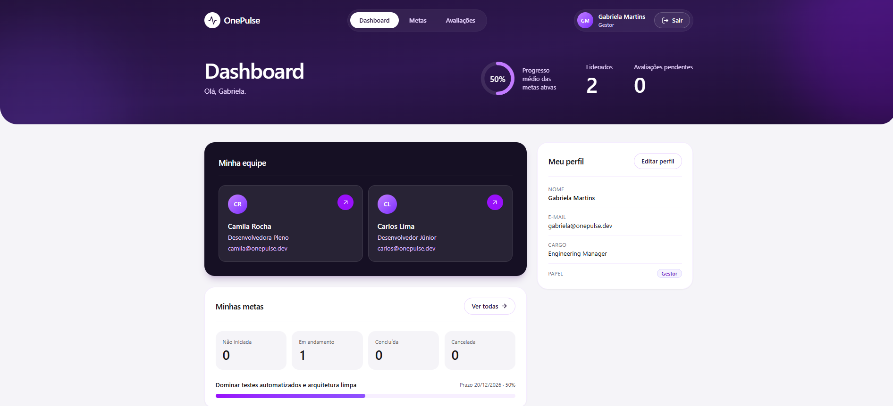
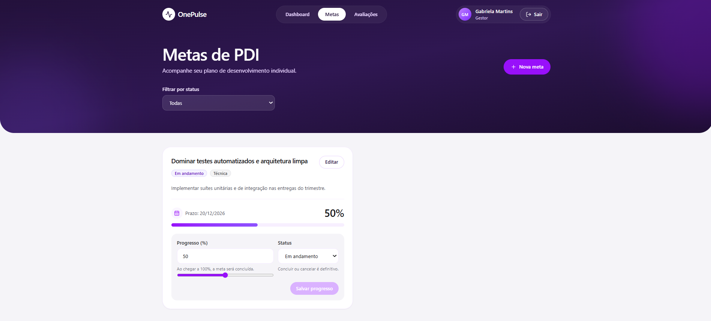
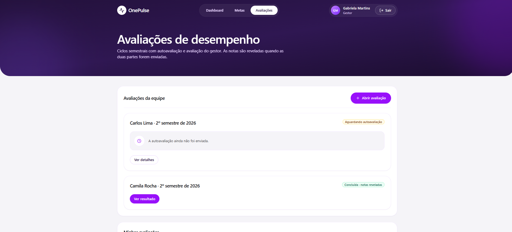

# OnePulse

Plataforma full-stack de gestão de pessoas que une **PDI (Plano de Desenvolvimento Individual)** e **avaliação de desempenho** em um só lugar, com acesso isolado por hierarquia.


---

## Visão geral

Em muitas empresas, o PDI vive numa planilha e a avaliação de desempenho acontece uma vez por semestre num formulário à parte. O resultado é feedback desconectado do desenvolvimento real e pouca visibilidade para quem lidera.

O OnePulse trata as duas coisas como um fluxo contínuo:

- **PDI contínuo:** o colaborador cria metas, atualiza o progresso e acompanha o feedback do gestor. Cada meta segue um ciclo de vida explícito (`NAO_INICIADA → EM_ANDAMENTO → CONCLUIDA | CANCELADA`).
- **Ciclos semestrais de avaliação** (`2026-S1`, `2026-S2`): o gestor abre a avaliação, o colaborador faz a autoavaliação e o gestor registra nota e feedback. A avaliação fecha sozinha quando as duas partes enviam.
- **Isolamento por hierarquia:** cada pessoa enxerga apenas o que lhe diz respeito. O colaborador vê os próprios dados. O gestor vê também os dos liderados diretos e nada além disso.

| Papel | O que pode fazer |
|---|---|
| `COLABORADOR` | Gerenciar as próprias metas de PDI, preencher a autoavaliação e consultar o feedback recebido |
| `GESTOR` | Tudo acima, mais acompanhar a equipe, comentar metas dos liderados e conduzir os ciclos de avaliação |

## Capturas de tela

| Dashboard | Metas de PDI | Avaliações |
|---|---|---|
|  |  |  |

---

## Arquitetura e decisões técnicas

### Spec-Driven Development + TDD

Nenhuma linha de código foi escrita sem uma especificação aprovada em [`specs/`](specs/). Cada spec define regras de negócio, contrato de API e critérios de aceite no formato Given/When/Then, cada um com um ID (`AUTH-02`, `PDI-07`, `EVR-06`...). Esse ID aparece no nome do teste correspondente, o que dá rastreabilidade direta entre requisito e verificação:

```ts
it('[AUTH-02] retorna 401 quando a senha está incorreta', ...)
```

O ciclo é sempre o mesmo: **spec → teste vermelho → implementação mínima → refatoração → verificação** (lint, typecheck e suíte completa).

**987 testes automatizados:**

- **844 no back-end:** testes unitários de regras e serviços, mais testes de integração com Supertest contra um **MySQL 8 real** (`onepulse_test`), sem mocks de banco.
- **143 no front-end:** Vitest + Testing Library, com a API simulada por **MSW** na camada de rede. Os testes verificam o comportamento visível ao usuário e não detalhes de implementação.

### Back-end em camadas

```
routes → controller → service → repository
```

- **Controllers** cuidam só de HTTP. **Services** concentram regras de negócio e autorização e não conhecem o Express. **Repositories** são o único lugar com SQL.
- **Funções puras de domínio:** as máquinas de estado de metas (`pd-goals.rules.ts`) e de avaliações (`evaluations.rules.ts`) não fazem I/O. Recebem o estado atual e as mudanças e devolvem o próximo estado ou lançam erro de domínio. Por isso são testáveis em milissegundos e reutilizáveis.
- **Validação na borda:** schemas Zod em middleware, antes do controller. Os tipos de entrada são derivados com `z.infer`, então o schema é a única fonte da verdade.
- **Erros padronizados:** toda falha sai no mesmo envelope `{ "error": { "code", "message", "details" } }` com status HTTP semântico.

### SQL explícito, sem ORM

O acesso a dados usa `mysql2/promise` com **queries 100% parametrizadas**. A escolha foi deliberada: com SQL explícito, o comportamento sob concorrência fica visível e testável, sem depender de abstrações de um ORM.

A concorrência é resolvida no próprio banco, sem o padrão "lê, verifica, escreve":

- **`UNIQUE` constraints** (`email`; `(user_id, cycle)` em avaliações) garantem que duas requisições simultâneas nunca criem duplicatas. A violação vira `409 Conflict`.
- **`DELETE` condicional atômico:** uma meta só pode ser excluída se ainda estiver `NAO_INICIADA`, e a condição vai dentro da própria query (`DELETE ... WHERE id = ? AND status = 'NAO_INICIADA'`). Isso elimina a janela entre checar o status e apagar.

### Segurança e privacidade

| Ameaça | Mitigação |
|---|---|
| Roubo de token via XSS | JWT apenas em cookie `HttpOnly` + `SameSite=Lax` (`Secure` em produção). O header `Authorization` é ignorado. |
| Sessão de usuário desativado | A cada requisição autenticada o usuário é recarregado do banco e precisa estar **ativo**. Um token válido de conta desativada não autentica. |
| Enumeração de falhas de login | Toda falha de autenticação devolve o mesmo `401`, sem indicar qual verificação falhou. |
| **IDOR** (acesso a recurso alheio por ID) | Escopo hierárquico verificado no service em toda rota. Recursos fora da equipe retornam um **`404` genérico**, indistinguível de "não existe", para não confirmar a existência do ID. |
| Viés na avaliação | **Visibilidade cega aplicada no servidor** por `toEvaluationDTO`, o único caminho de uma avaliação para fora da API. O colaborador só vê a nota do gestor depois que a avaliação é concluída, e o gestor nunca vê o rascunho da autoavaliação. Campos ocultos saem como `null`, então a regra não depende do front-end. |
| Vazamento de dados sensíveis | Senhas com hash **bcrypt**. DTOs com lista explícita de campos: `password_hash` nunca é serializado, e um campo novo não vaza por acidente. |
| SQL injection | Queries sempre parametrizadas (`?`). |
| Segredos no repositório | Configuração via `.env` validado com Zod na inicialização. Apenas `.env.example` é versionado. |

### Front-end

- **React 19** + **TypeScript strict**, **Tailwind CSS v4**, **React Router v7** com guards por papel.
- **TanStack Query v5** como única fonte de estado de servidor, sem duplicação em `useState` ou contexto.
- **Sem atualização otimista, por decisão de projeto.** Progresso, status e conclusão de avaliações são invariantes calculadas no servidor. Atualizar a UI de forma otimista significaria reimplementar essas regras no cliente e arriscar divergência, então a interface reflete sempre a resposta da API e invalida as queries afetadas.
- Chamadas HTTP centralizadas em `services/` com `credentials: 'include'`. Lógica em hooks (`useGoals`, `useCreateGoal`...). Componentes pequenos e acessíveis (labels, foco visível, HTML semântico).

---

## Stack

| Camada | Tecnologias |
|---|---|
| **Infra** | Docker Compose, MySQL 8.0 |
| **Back-end** | Node.js 24+, Express 5, TypeScript, mysql2, Zod, JWT, bcrypt |
| **Front-end** | React 19, Vite, TypeScript, Tailwind CSS v4, TanStack Query v5, React Router v7, Lucide |
| **Testes** | Vitest, Supertest, Testing Library, MSW |
| **Qualidade** | ESLint, `tsc --noEmit`, Conventional Commits |

## Estrutura de pastas

```
one-pulse/
├── specs/                    # SDD: especificações e critérios de aceite (fonte da verdade)
├── docker-compose.yml        # MySQL 8.0 (cria também o banco de testes)
├── backend/
│   ├── src/
│   │   ├── app.ts            # monta o app Express (sem listen, testável com Supertest)
│   │   ├── server.ts         # bootstrap
│   │   ├── config/           # env validado com Zod, pool do MySQL
│   │   ├── shared/           # AppError, middlewares (RBAC, validação, erro), schemas
│   │   └── modules/          # vertical slices: auth, users, pd-goals, evaluations
│   │       └── <módulo>/     # routes · controller · service · repository · rules · policy · schemas
│   ├── database/             # migrations SQL versionadas, migrator e seed
│   └── tests/                # integração (Supertest + MySQL real), helpers e fixtures
└── frontend/
    └── src/
        ├── features/         # auth, dashboard, pdi, evaluations, team, profile
        ├── components/       # UI genérica e layout
        ├── routes/           # rotas e guards por papel
        ├── services/         # cliente HTTP base
        └── lib/              # queryClient e utilitários
```

---

## Como executar localmente

**Pré-requisitos:** Node.js 24+ e Docker.

**1. Banco de dados**

```bash
cp .env.example .env              # defina senhas próprias para o MySQL
docker compose up -d
docker compose ps                 # aguarde o status "healthy"
```

**2. Back-end** (API em `http://localhost:3333`)

```bash
cd backend
cp .env.example .env              # use as mesmas credenciais do .env da raiz e gere um JWT_SECRET
npm install
npm run db:migrate
npm run seed
npm run dev
```

Para gerar um `JWT_SECRET` forte:

```bash
node -e "console.log(require('crypto').randomBytes(48).toString('hex'))"
```

**3. Front-end** (em `http://localhost:5173`, com proxy de `/api` para o back-end)

```bash
cd frontend
npm install
npm run dev
```

### Usuários de demonstração

O seed é idempotente e cria duas equipes. Todos os usuários usam a senha definida em `SEED_USER_PASSWORD` no `backend/.env`.

| Usuário | Papel | Equipe |
|---|---|---|
| `gabriela@onepulse.dev` | Gestora | Engenharia (Carlos e Camila) |
| `carlos@onepulse.dev` | Colaborador | Liderado por Gabriela |
| `gustavo@onepulse.dev` | Gestor | Produto (Diego) |

> As credenciais do seed existem apenas para desenvolvimento local. Nunca rode o seed em um ambiente exposto.

Para ver o isolamento hierárquico funcionando, entre como Gabriela e depois como Gustavo: nenhum enxerga a equipe do outro.

### Testes e qualidade

```bash
# back-end (requer o MySQL rodando)
npm test                    # suíte completa
npm run test:unit           # somente unitários, sem banco
npm run test:integration    # integração contra o onepulse_test
npm run typecheck

# front-end (não precisa do back-end)
npm test
npm run typecheck
npm run lint
```

---

## Especificações

| Spec | Escopo |
|---|---|
| [`00-architecture`](specs/00-architecture.spec.md) | Domínio, modelo de dados, RBAC e ADRs |
| [`01-auth`](specs/01-auth.spec.md) | Cadastro, login, sessão via cookie |
| [`02-users`](specs/02-users.spec.md) | Perfil e equipe |
| [`03-pd-goals`](specs/03-pd-goals.spec.md) | Metas de PDI e máquina de estados |
| [`04-evaluations`](specs/04-evaluations.spec.md) | Ciclos de avaliação e visibilidade cega |
| [`05-frontend`](specs/05-frontend.spec.md) | Telas, fluxos e critérios de UI |
