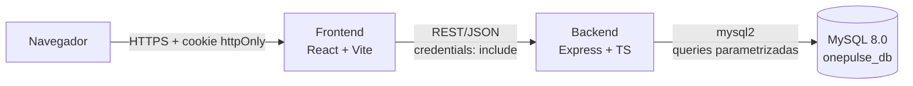
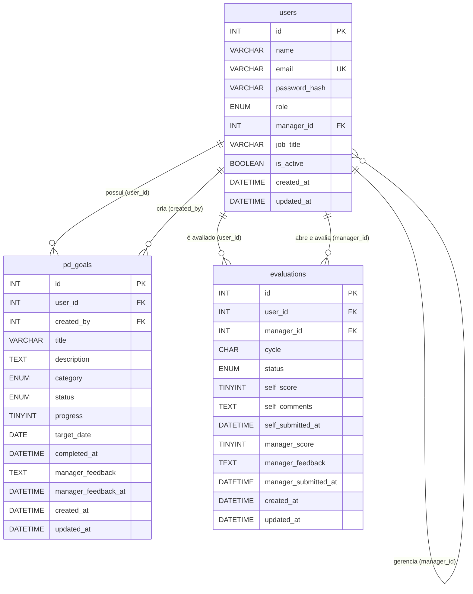

# 00 — Arquitetura e Planejamento Inicial

| Campo | Valor |
|---|---|
| Status | ✅ Aprovada |
| Versão | 1.3.0 (§2.1 e §3.4: avaliação em registro único com duas partes, via spec 04 E-01..E-06) · 1.2.0 (§3.3: `target_date`, parecer do gestor e índice da listagem, via spec 03 E-01..E-03) |
| Data | 2026-11-24 |
| Escopo | Visão de produto, papéis (RBAC), modelo de dados |

---

## 1. Visão Geral do Produto

**Problema.** Em muitas empresas, o desenvolvimento das pessoas fica espalhado em planilhas, conversas de 1:1 esquecidas e avaliações anuais sem histórico. Os colaboradores não sabem com clareza o que se espera deles, e os gestores não têm visão consolidada da evolução do time.

**Solução.** O OnePulse centraliza dois fluxos:

1. **PDI (Plano de Desenvolvimento Individual):** metas de desenvolvimento com prazo, categoria e progresso acompanhável.
2. **Avaliação de Desempenho:** ciclos de avaliação com autoavaliação do colaborador e avaliação do gestor, gerando histórico comparável.

**Proposta de valor**
- **Colaborador:** clareza sobre o que desenvolver e visibilidade do próprio progresso.
- **Gestor:** visão consolidada do time, apoio a 1:1s e decisões baseadas em histórico.

### 1.1 Escopo do MVP

| Dentro do MVP | Fora do MVP (futuro) |
|---|---|
| Autenticação (login/logout, sessão via cookie) | SSO / OAuth |
| Perfil do usuário e vínculo gestor → liderados | Organograma com múltiplos níveis, departamentos |
| CRUD de metas de PDI + atualização de progresso | Comentários e feedback contínuo nas metas |
| Autoavaliação e avaliação do gestor por ciclo | Avaliação 360°, competências ponderadas |
| Dashboard do gestor com visão do time | Relatórios exportáveis, notificações por e-mail |

### 1.2 Arquitetura de Alto Nível

- **Monorepo** com `backend/` e `frontend/` independentes (cada um com seu `package.json`).
- **API REST** com prefixo `/api/v1`.
- **Sessão stateless** com JWT assinado, enviado em cookie `httpOnly`, `SameSite=Lax`, `Secure` em produção. O front-end nunca tem acesso ao token, o que mitiga roubo via XSS.

---

## 2. Papéis de Usuário (RBAC)

O sistema tem dois papéis, armazenados em `users.role`:

| Papel | Descrição |
|---|---|
| `COLABORADOR` | Gerencia o próprio PDI e faz a própria autoavaliação. |
| `GESTOR` | Tudo o que um colaborador faz **+** acompanha e avalia seus **liderados diretos** (`users.manager_id = gestor.id`). |

> **Princípio:** o papel diz *o que* a pessoa pode fazer; a **relação de liderança** diz *sobre quem*. Um gestor não tem acesso a dados de colaboradores de outros times. Isso é RBAC combinado com verificação de ownership/relacionamento.

### 2.1 Matriz de Permissões

| Recurso / Ação | COLABORADOR | GESTOR |
|---|---|---|
| Ver/editar o próprio perfil (nome, cargo) | ✅ | ✅ |
| Alterar `role` ou `manager_id` de alguém | ❌ | ❌ (MVP: somente via seed/admin) |
| Listar liderados diretos | ❌ | ✅ |
| **PDI:** criar/editar/excluir metas próprias | ✅ | ✅ |
| **PDI:** ver metas de liderados diretos | ❌ | ✅ |
| **PDI:** criar meta para um liderado direto | ❌ | ✅ |
| **PDI:** ver metas de qualquer outro usuário | ❌ | ❌ |
| **Avaliação:** abrir avaliação (ciclo) de liderado direto | ❌ | ✅ |
| **Avaliação:** preencher a própria autoavaliação (a avaliação é aberta pelo gestor) | ✅ | ✅ |
| **Avaliação:** avaliar um liderado direto | ❌ | ✅ |
| **Avaliação:** ver avaliação do gestor sobre si | ✅ (somente `CONCLUIDA`) | ✅ (somente `CONCLUIDA`) |
| **Avaliação:** ver autoavaliação de liderado | ❌ | ✅ (somente após o envio; rascunho nunca) |
| **Avaliação:** editar uma parte após enviada | ❌ | ❌ |

### 2.2 Regras de Autorização (transversais)

- **RBAC-01:** requisição sem cookie de sessão válido em rota protegida → `401 UNAUTHENTICATED`.
- **RBAC-02:** usuário autenticado sem permissão para a ação → `403 FORBIDDEN`.
- **RBAC-03:** um recurso que existe mas não pertence ao escopo do usuário retorna `404 NOT_FOUND`, não `403`, para não revelar que ele existe (evita enumeração/IDOR).
- **RBAC-04:** o papel e o `id` do usuário vêm **sempre** do JWT validado, nunca do corpo da requisição.

---

## 3. Modelo de Dados

### 3.1 Diagrama ER

### 3.2 Tabela `users`

| Coluna | Tipo | Restrições | Observação |
|---|---|---|---|
| `id` | `INT UNSIGNED` | PK, `AUTO_INCREMENT` | |
| `name` | `VARCHAR(120)` | `NOT NULL` | |
| `email` | `VARCHAR(255)` | `NOT NULL`, `UNIQUE` | Armazenado em minúsculas (normalizado no service). |
| `password_hash` | `VARCHAR(255)` | `NOT NULL` | bcrypt, custo ≥ 10. **Nunca** sai na API. |
| `role` | `ENUM('COLABORADOR','GESTOR')` | `NOT NULL`, default `'COLABORADOR'` | |
| `manager_id` | `INT UNSIGNED` | `NULL`, FK → `users.id` `ON DELETE SET NULL` | Gestor direto. |
| `job_title` | `VARCHAR(120)` | `NULL` | |
| `is_active` | `BOOLEAN` | `NOT NULL`, default `TRUE` | Soft-disable: usuários inativos não fazem login. |
| `created_at` | `DATETIME` | `NOT NULL`, default `CURRENT_TIMESTAMP` | UTC |
| `updated_at` | `DATETIME` | `NOT NULL`, default `CURRENT_TIMESTAMP ON UPDATE CURRENT_TIMESTAMP` | UTC |

Índices: `UNIQUE(email)`, `INDEX(manager_id)`.
Regra **USR-INV-01:** ninguém é gestor de si mesmo (`manager_id <> id`). Validada no **service/seed**, não por `CHECK` (veja a nota 3.5).

### 3.3 Tabela `pd_goals` (metas de PDI)

| Coluna | Tipo | Restrições | Observação |
|---|---|---|---|
| `id` | `INT UNSIGNED` | PK, `AUTO_INCREMENT` | |
| `user_id` | `INT UNSIGNED` | `NOT NULL`, FK → `users.id` `ON DELETE CASCADE` | Dono da meta. |
| `created_by` | `INT UNSIGNED` | `NOT NULL`, FK → `users.id` `ON DELETE RESTRICT` | O próprio dono ou o gestor dele (auditoria). |
| `title` | `VARCHAR(150)` | `NOT NULL` | |
| `description` | `TEXT` | `NULL` | |
| `category` | `ENUM('TECNICA','COMPORTAMENTAL','CARREIRA')` | `NOT NULL` | |
| `status` | `ENUM('NAO_INICIADA','EM_ANDAMENTO','CONCLUIDA','CANCELADA')` | `NOT NULL`, default `'NAO_INICIADA'` | |
| `progress` | `TINYINT UNSIGNED` | `NOT NULL`, default `0`, `CHECK (progress BETWEEN 0 AND 100)` | Percentual. |
| `target_date` | `DATE` | `NOT NULL` | Prazo da meta (API: `targetDate`, `AAAA-MM-DD`). Renomeado de `due_date` na v1.2.0. |
| `completed_at` | `DATETIME` | `NULL` | Preenchido quando `status = CONCLUIDA`. |
| `manager_feedback` | `TEXT` | `NULL` | Parecer único do gestor direto (v1.2.0; não é o feedback contínuo fora do MVP). |
| `manager_feedback_at` | `DATETIME` | `NULL` | Quando o parecer foi registrado (v1.2.0). |
| `created_at` / `updated_at` | `DATETIME` | como em `users` | |

Índices: `INDEX(user_id, status)`, `INDEX(created_by)`, `INDEX(user_id, target_date)` (ordenação da listagem, v1.2.0).

Regras completas de ciclo de vida, transições e permissões: [`03-pd-goals.spec.md`](03-pd-goals.spec.md).

**Regras de negócio (invariantes, validadas no service):**
- **PDI-INV-01:** `status = CONCLUIDA` ⇔ `progress = 100` e `completed_at` preenchido.
- **PDI-INV-02:** `progress > 0` com status `NAO_INICIADA` muda automaticamente para `EM_ANDAMENTO`.
- **PDI-INV-03:** metas `CANCELADA` ou `CONCLUIDA` não aceitam alteração de progresso.
- **PDI-INV-04:** `created_by` é o próprio `user_id` **ou** o `manager_id` dele.

### 3.4 Tabela `evaluations` (avaliações de desempenho)

Um registro por pessoa por ciclo, com **duas partes independentes**: a autoavaliação (`self_*`) e a avaliação do gestor (`manager_*`). Modelo revisado na v1.3.0 (spec 04 E-01..E-05).

| Coluna | Tipo | Restrições | Observação |
|---|---|---|---|
| `id` | `INT UNSIGNED` | PK, `AUTO_INCREMENT` | |
| `user_id` | `INT UNSIGNED` | `NOT NULL`, FK → `users.id` `ON DELETE CASCADE` | Quem é avaliado. |
| `manager_id` | `INT UNSIGNED` | `NOT NULL`, FK → `users.id` `ON DELETE RESTRICT` | Gestor direto que abriu a avaliação (snapshot). |
| `cycle` | `CHAR(7)` | `NOT NULL` | Formato `AAAA-SN` (ex.: `2026-S2`), validado por regex no Zod. |
| `status` | `ENUM('ABERTA','CONCLUIDA')` | `NOT NULL`, default `'ABERTA'` | `CONCLUIDA` quando as duas partes foram enviadas. |
| `self_score` | `TINYINT UNSIGNED` | `NULL`, `CHECK (self_score BETWEEN 1 AND 5)` | Obrigatória para enviar a autoavaliação. |
| `self_comments` | `TEXT` | `NULL` | Opcional. |
| `self_submitted_at` | `DATETIME` | `NULL` | Envio da autoavaliação. |
| `manager_score` | `TINYINT UNSIGNED` | `NULL`, `CHECK (manager_score BETWEEN 1 AND 5)` | Obrigatória para enviar a avaliação do gestor. |
| `manager_feedback` | `TEXT` | `NULL` | Obrigatório para enviar a avaliação do gestor. |
| `manager_submitted_at` | `DATETIME` | `NULL` | Envio da avaliação do gestor. |
| `created_at` / `updated_at` | `DATETIME` | como em `users` | |

Índices: `UNIQUE(user_id, cycle)`, `INDEX(manager_id, cycle)`.

Regras completas de abertura, preenchimento, envio e visibilidade: [`04-evaluations.spec.md`](04-evaluations.spec.md).

**Regras de negócio:**
- **EVAL-INV-01:** uma avaliação por pessoa por ciclo (garantido pelo `UNIQUE`; violação → `409 EVALUATION_ALREADY_EXISTS`).
- **EVAL-INV-02:** `manager_id` é o `users.manager_id` do avaliado **no momento da abertura**, e `manager_id <> user_id`. Validada no **service** (veja a nota 3.5).
- **EVAL-INV-03:** `status = CONCLUIDA` ⇔ `self_submitted_at` e `manager_submitted_at` preenchidos.
- **EVAL-INV-04:** enviar a autoavaliação exige `self_score`; enviar a avaliação do gestor exige `manager_score` e `manager_feedback`. Depois de enviada, a parte é imutável.

### 3.5 Nota: limites de `CHECK` no MySQL 8 (adicionada na v1.1.0)

Validado contra o MySQL 8.0.46 em 2026-11-22:

- **ERROR 3818:** um `CHECK` não pode referenciar uma coluna `AUTO_INCREMENT`. Isso inviabiliza `manager_id <> id`.
- **ERROR 3823:** um `CHECK` não pode usar uma coluna que participa de FK com ação referencial (`CASCADE`, `SET NULL`). Isso inviabiliza um `CHECK (manager_id <> user_id)` em `evaluations` (EVAL-INV-02).

**Decisão:** `CHECK` no banco apenas sobre colunas simples (`progress`, `self_score`, `manager_score`). Invariantes que relacionam IDs ficam no service, com testes unitários dedicados. Os `CHECK`s de `progress`, `self_score` e `manager_score` continuam valendo.

---

## 4. Decisões de Arquitetura (ADRs resumidos)

| # | Decisão | Alternativa descartada | Motivo |
|---|---|---|---|
| ADR-01 | **mysql2** com SQL explícito, repositories e migrations em `.sql` | Sequelize (ORM) | Demonstra domínio de SQL, menos "mágica" e controle total das queries. O repository isola o acesso a dados, então trocar por ORM depois continua viável. |
| ADR-02 | PK `INT UNSIGNED AUTO_INCREMENT` | UUID | Mais simples e com índice menor. O risco de enumeração é mitigado pela RBAC-03 (escopo verificado em toda consulta). |
| ADR-03 | JWT em cookie `httpOnly` | Token em `localStorage` | O token fica inacessível a JavaScript (mitiga XSS). O CSRF é mitigado com `SameSite=Lax` + API JSON-only. |
| ADR-04 | Hierarquia via `users.manager_id` | Tabela `teams` | Atende o MVP (gestor → liderados diretos) sem complexidade extra. |
| ADR-05 | Enums do domínio em português | Inglês | Linguagem ubíqua: os termos são os mesmos que o RH/negócio usa. |
| ADR-06 | Datas em UTC no banco e na API (ISO 8601) | Fuso local | Evita bugs de timezone. A conversão acontece só na apresentação. |

---

## 5. Decisões de Produto (resolvidas em 2026-11-22)

1. **Cadastro de usuários:** `POST /auth/register` é público e sempre cria um `COLABORADOR`. `GESTOR` e os vínculos de `manager_id` são criados somente via seed.
2. **Ciclos de avaliação:** semestrais (`AAAA-SN`) no MVP.
3. **Gestor também é avaliado:** sim, quando tiver `manager_id` (o gestor dele o avalia).
4. **Exclusão de metas:** hard delete permitido apenas com status `NAO_INICIADA`. Depois disso, só é possível mudar para `CANCELADA`.

---

## 6. Roadmap de Specs

| Spec | Fase | Conteúdo |
|---|---|---|
| `01-auth.spec.md` | 1 | Login, logout, `/me`, middleware de autenticação e RBAC |
| `02-users.spec.md` | 2 | Perfil, listagem de liderados |
| `03-pd-goals.spec.md` | 3 | CRUD de PDI e regras de progresso |
| `04-evaluations.spec.md` | 4 | Ciclo de avaliação (abertura pelo gestor, duas partes, envio e visibilidade cega) |
| `05-frontend.spec.md` | 5 | Fluxos de tela, rotas e guards por papel |
