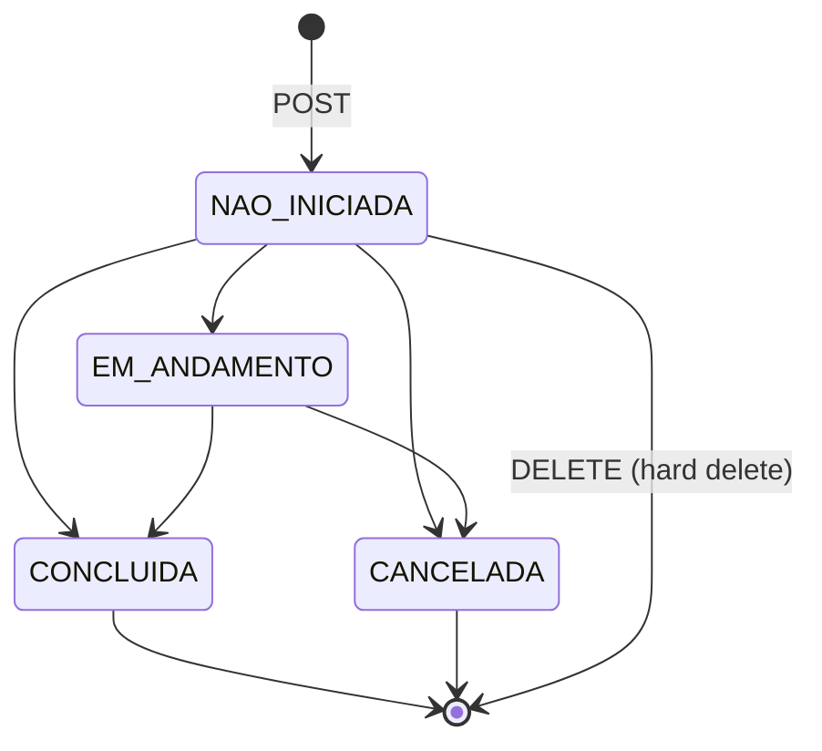

# 03 — Metas de PDI (`pd_goals`)

| Campo | Valor |
|---|---|
| Status | 🏁 Concluída: GOAL-01..45 cobertos, 538 testes verdes na suíte completa (2026-11-24) |
| Versão | 1.0.0 |
| Data | 2026-11-24 |
| Depende de | [`00-architecture.spec.md`](00-architecture.spec.md) v1.2.0 (§2 RBAC, §3.3 `pd_goals`, PDI-INV-01..04) · [`01-auth.spec.md`](01-auth.spec.md) (sessão, envelope de erro) · [`02-users.spec.md`](02-users.spec.md) (`canViewUser`, padrão de 404, `requireRole`) |
| Branch | `feat/phase-3-pd-goals` |

---

## 1. Objetivo

Permitir que **cada usuário** gerencie as próprias metas de PDI (criar, acompanhar progresso, concluir, cancelar, excluir enquanto não iniciada) e que o **GESTOR** acompanhe as metas dos **liderados diretos**: criar metas para eles, consultá-las e registrar um **parecer** (feedback) em cada uma.

**Fora do escopo desta fase:**
- feedback contínuo / thread de comentários nas metas (spec 00 §1.1: fora do MVP; aqui existe **um** parecer por meta, editável);
- reabrir metas `CONCLUIDA` ou `CANCELADA` (veja a Q-04);
- paginação, busca e filtros adicionais na listagem (por status, categoria, prazo);
- visão agregada de "todas as metas da equipe" em uma única chamada (o dashboard da Fase 5 decide se precisa);
- indicador calculado de atraso (`isOverdue`): derivável no front-end a partir de `targetDate` e `status`;
- controle de concorrência otimista (dois PATCHes simultâneos: vale o último).

---

## 2. Regras de Domínio

### 2.1 Definições

| Termo | Definição |
|---|---|
| **Dono** (`owner`) | O usuário em `pd_goals.user_id`. A meta é *dele*, mesmo que tenha sido criada pelo gestor. |
| **Criador** (`createdBy`) | Quem fez o `POST`: o próprio dono ou o gestor direto dele (PDI-INV-04). Campo de auditoria, sem efeito em permissões. |
| **Gestor direto da meta** | Usuário `GESTOR` tal que `owner.manager_id = gestor.id`, com o dono **ativo**. Avaliado **no momento da requisição** (se o liderado trocar de gestor, o gestor antigo perde o acesso). |
| **Estado terminal** | `CONCLUIDA` ou `CANCELADA`. |

### 2.2 Política de acesso: `getGoalAccess(viewer, owner)`

Função **pura** em `pd-goals.policy.ts`. Reutiliza `canViewUser` (spec 02 §2.2) e devolve o **papel do viewer em relação à meta**:

```
if (!canViewUser(viewer, owner)) return 'NONE'
if (owner.id === viewer.id)      return 'OWNER'
return 'MANAGER'                   // canViewUser garante: viewer é GESTOR e owner é liderado direto ativo
```

| Viewer ↓ / Dono da meta → | Ele mesmo | Liderado direto ativo | Liderado direto inativo | Par da mesma equipe | Próprio gestor | Outro time |
|---|---|---|---|---|---|---|
| **COLABORADOR** | `OWNER` | n/a | n/a | `NONE` | `NONE` | `NONE` |
| **GESTOR** | `OWNER` | `MANAGER` | `NONE` | `NONE` | `NONE` | `NONE` |

### 2.3 Matriz de permissões por ação

| Ação | `OWNER` | `MANAGER` | `NONE` |
|---|---|---|---|
| Criar meta (§4.1) | ✅ para si | ✅ para o liderado | `404` (usuário) |
| Listar / ver detalhe | ✅ | ✅ | `404` |
| Editar conteúdo (`title`, `description`, `category`, `targetDate`) | ✅ (se não terminal) | `403` | `404` |
| Alterar `status` / `progress` | ✅ (se não terminal) | `403` | `404` |
| Registrar/editar/remover `managerFeedback` | `403` | ✅ (inclusive em estado terminal) | `404` |
| Excluir | ✅ (só `NAO_INICIADA`) | `403` | `404` |

> **Por que o gestor não edita o conteúdo nem o status?** A meta é do liderado: é ele quem declara o próprio progresso. O gestor participa criando a meta (quando combinado em 1:1) e registrando o parecer. Isso separa claramente "o que eu digo que fiz" de "o que meu gestor achou", algo importante quando o histórico do PDI alimentar a avaliação da Fase 4.

> **Um GESTOR dando parecer na própria meta → `403`.** O parecer é do gestor **direto do dono**. Para a meta de um gestor, quem dá parecer é o gestor *dele* (se houver).

### 2.4 Máquina de estados do `status`



| De ↓ / Para → | `NAO_INICIADA` | `EM_ANDAMENTO` | `CONCLUIDA` | `CANCELADA` |
|---|---|---|---|---|
| `NAO_INICIADA` | ✅ (sem efeito) | ✅ | ✅ | ✅ |
| `EM_ANDAMENTO` | ❌ `409 INVALID_STATUS_TRANSITION` | ✅ (sem efeito) | ✅ | ✅ |
| `CONCLUIDA` | `409 GOAL_LOCKED` | `409 GOAL_LOCKED` | `409 GOAL_LOCKED` | `409 GOAL_LOCKED` |
| `CANCELADA` | `409 GOAL_LOCKED` | `409 GOAL_LOCKED` | `409 GOAL_LOCKED` | `409 GOAL_LOCKED` |

- **Estado terminal trava todos os campos do dono** (conteúdo, `status`, `progress`): qualquer PATCH do dono em meta terminal → `409 GOAL_LOCKED`, mesmo que os valores enviados sejam iguais aos atuais. O `managerFeedback` **não** é travado.
- **`EM_ANDAMENTO → NAO_INICIADA` é proibido** para manter a regra de exclusão honesta: "voltar" para não iniciada reabriria a porta do hard delete de uma meta que já teve histórico.

### 2.5 Regras de progresso (implementam PDI-INV-01..03)

O service calcula o **estado final** da meta a partir do estado atual + mudanças, com uma função **pura** `applyGoalChanges(current, changes, now)`:

| # | Regra | Exemplo |
|---|---|---|
| **PRG-01** | `progress` é inteiro de 0 a 100. | `50.5`, `-1`, `101`, `"50"` → `400`. |
| **PRG-02** (PDI-INV-02) | Meta `NAO_INICIADA` que recebe `progress > 0` sem `status` explícito passa a `EM_ANDAMENTO`. | `{ progress: 30 }` em `NAO_INICIADA` → `EM_ANDAMENTO`, 30. |
| **PRG-03** (PDI-INV-01) | `progress = 100` sem `status` explícito conclui a meta. | `{ progress: 100 }` → `CONCLUIDA`. |
| **PRG-04** (PDI-INV-01) | Ao ficar `CONCLUIDA` (explícita ou via PRG-03): `progress = 100` e `completedAt = now`. | `{ status: "CONCLUIDA" }` com progresso 40 → 100. |
| **PRG-05** | `CANCELADA` congela o `progress` atual; `completedAt` continua `null`. | 40% → cancelada com 40%. |
| **PRG-06** | Em `EM_ANDAMENTO`, o `progress` pode subir ou descer livremente entre 0 e 99 (inclusive voltar a 0). | 60 → 20 é válido. |
| **PRG-07** (PDI-INV-03) | Terminal não aceita `progress` (coberto por `GOAL_LOCKED`, §2.4). | |
| **PRG-08** | `NAO_INICIADA → EM_ANDAMENTO` sem `progress` mantém o valor atual (0). | `{ status: "EM_ANDAMENTO" }` → 0%. |

**Combinações contraditórias no mesmo payload** são rejeitadas **no schema** (`400`), porque são inválidas independentemente do estado da meta:

| `status` enviado | `progress` permitido junto |
|---|---|
| `NAO_INICIADA` | ausente ou `0` |
| `EM_ANDAMENTO` | ausente ou `0..99` |
| `CONCLUIDA` | ausente ou `100` |
| `CANCELADA` | ausente |

### 2.6 Prazo (`targetDate`)

- Formato `AAAA-MM-DD` (data de calendário real: `2026-02-30` é inválido). Armazenado em coluna `DATE`, sem horário (ADR-06: não há conversão de fuso para uma data pura).
- **Obrigatório** na criação; não aceita `null` na edição (veja a Q-01).
- **Sempre que enviado** (criação ou edição), deve ser **≥ hoje em UTC**. Hoje é aceito. A comparação usa um relógio **injetado** no service (`now()`), para os testes unitários serem determinísticos.
- Uma meta pode ficar com prazo vencido com o passar do tempo; isso não bloqueia nada. Para estender, o dono envia um novo `targetDate` ≥ hoje.

> **Trade-off do "hoje em UTC":** às 22h em Brasília (01h UTC do dia seguinte) o usuário não consegue escolher a data "de hoje" local. Aceito no MVP pela simplicidade e pela coerência com ADR-06; o front-end pode usar o mínimo `hoje UTC` no seletor de data.

### 2.7 Regras de resposta para recursos fora do escopo (RBAC-03)

| Situação | Resposta (corpo **idêntico** dentro de cada linha) |
|---|---|
| `:id` da meta inexistente **ou** meta cujo dono não é visível ao viewer (`NONE`) | `404 { "error": { "code": "NOT_FOUND", "message": "Meta não encontrada." } }` |
| `userId` (query do GET ou corpo do POST) inexistente, inativo ou fora do escopo | `404 { "error": { "code": "NOT_FOUND", "message": "Usuário não encontrado." } }` (mesmo corpo da spec 02 §2.4) |

`403 FORBIDDEN` só aparece quando o viewer **já pode ver** a meta (`OWNER` ou `MANAGER`) e tenta uma ação que o papel dele em relação à meta não permite (§2.3). Como ele já enxerga a meta, o `403` não revela nada.

### 2.8 Ordem de avaliação (todas as rotas)

```
401 (sessão) → 400 (formato de :id, query e corpo) → 404 (existência + escopo) → 403 (ação × papel na meta) → 409 (estado da meta) → 2xx
```

O `400` vem antes do `404` porque depende só do que o cliente enviou, não do banco: não vaza informação.

### 2.9 Novos códigos de erro (somam-se aos das specs 01 e 02)

| HTTP | `code` | Quando | Mensagem |
|---|---|---|---|
| 409 | `INVALID_STATUS_TRANSITION` | Transição proibida na §2.4 (hoje, só `EM_ANDAMENTO → NAO_INICIADA`). | "Transição de status inválida: de EM_ANDAMENTO para NAO_INICIADA." |
| 409 | `GOAL_LOCKED` | Dono tenta alterar meta `CONCLUIDA`/`CANCELADA`. | "Metas concluídas ou canceladas não podem ser alteradas." |
| 409 | `GOAL_NOT_DELETABLE` | `DELETE` de meta que não está `NAO_INICIADA`. | "Apenas metas não iniciadas podem ser excluídas. Para encerrar esta meta, altere o status para CANCELADA." |

> **Por que `409` e não `422`?** `409 Conflict` significa "a requisição é válida, mas conflita com o **estado atual** do recurso", que é exatamente o caso: o mesmo PATCH seria aceito se a meta estivesse em outro status. O `422` ficaria ambíguo com o nosso `400 VALIDATION_ERROR` e não está na lista de status do CLAUDE.md.

---

## 3. Schemas de Validação (Zod)

### 3.1 `goalIdParamSchema` (`:id`)

Mesma regra do `userIdParamSchema` (spec 02 §3.1): `^[1-9]\d{0,9}$` e ≤ `4294967295`. Erro: `details: [{ field: "id", message: "ID de meta inválido." }]`. Implementação: extrair um helper `idParam(message)` compartilhado em `shared/`, para não duplicar a regex.

### 3.2 `listGoalsQuerySchema` (`GET /pd-goals`): `strictObject`

| Campo | Regras |
|---|---|
| `userId` | opcional · mesma regra de ID · `details.field = "userId"`, mensagem "ID de usuário inválido." |

Qualquer outro parâmetro de query → `400` (`field` = nome do parâmetro). Parâmetro repetido (`?userId=1&userId=2`) → `400`.

### 3.3 `createGoalSchema` (`POST /pd-goals`): `strictObject`

| Campo | Regras | Mensagem |
|---|---|---|
| `title` | obrigatório · string · `trim()` · 3 a 150 caracteres | "Título deve ter entre 3 e 150 caracteres." |
| `description` | opcional · `null` **ou** string · `trim()` · 1 a 2000 caracteres | "Descrição deve ter entre 1 e 2000 caracteres, ou null." |
| `category` | obrigatório · `TECNICA` \| `COMPORTAMENTAL` \| `CARREIRA` | "Categoria inválida." |
| `targetDate` | obrigatório · `AAAA-MM-DD`, data de calendário válida | "Prazo deve ser uma data válida no formato AAAA-MM-DD." |
| `userId` | opcional · inteiro positivo ≤ `4294967295` (número JSON, não string) · ausente = o próprio viewer | "ID de usuário inválido." |

- `status`, `progress`, `createdBy`, `completedAt`, `managerFeedback`, `id` etc. → `400` (mass assignment): o status inicial é **sempre** `NAO_INICIADA` e o progresso **sempre** 0.
- A regra "`targetDate` ≥ hoje" fica no **service** (depende do relógio), com o mesmo envelope: `400 VALIDATION_ERROR`, `details: [{ field: "targetDate", message: "Prazo não pode estar no passado." }]`.

### 3.4 `updateGoalSchema` (`PATCH /pd-goals/:id`): `strictObject`

| Campo | Regras | Quem pode |
|---|---|---|
| `title` | como na criação | `OWNER` |
| `description` | como na criação (`null` remove) | `OWNER` |
| `category` | como na criação | `OWNER` |
| `targetDate` | como na criação, **sem** `null` | `OWNER` |
| `status` | enum dos 4 status | `OWNER` |
| `progress` | inteiro 0..100 (PRG-01) | `OWNER` |
| `managerFeedback` | `null` **ou** string · `trim()` · 1 a 2000 caracteres | `MANAGER` |

- Pelo menos **um** campo (`field: "body"`, "Informe ao menos um campo para atualizar.").
- Combinações `status` × `progress` da §2.5 → `400` com `field: "progress"`.
- `userId`, `createdBy`, `completedAt`, `managerFeedbackAt`, `id` etc. → `400`.
- `managerFeedback: ""` ou `"   "` → `400`. Para remover, envie `null` (mesma decisão da spec 02 D-07).
- A checagem "quem pode" é feita no **service**, depois do `404` (§2.8). **Payload misto** (ex.: gestor enviando `managerFeedback` + `title`) → `403` inteiro; nada é alterado (tudo ou nada).

---

## 4. Contrato da API

Prefixo: `/api/v1/pd-goals`. **Todas** as rotas exigem `requireAuth` (sem sessão → `401 UNAUTHENTICATED`).

### 4.0 `GoalDTO`

```json
{
  "id": 10,
  "userId": 2,
  "createdBy": 1,
  "title": "Aprender testes de integração",
  "description": "Cobrir a API de usuários com Supertest.",
  "category": "TECNICA",
  "status": "EM_ANDAMENTO",
  "progress": 40,
  "targetDate": "2027-03-31",
  "completedAt": null,
  "managerFeedback": "Ótimo avanço, inclua testes de RBAC.",
  "managerFeedbackAt": "2026-11-24T15:00:00.000Z",
  "createdAt": "2026-11-24T12:00:00.000Z",
  "updatedAt": "2026-11-24T15:00:00.000Z"
}
```

- `targetDate` é string `AAAA-MM-DD` (data pura); os demais horários são ISO 8601 em UTC.
- `managerFeedback` é visível ao **dono** e ao **gestor** (transparência do parecer).
- O DTO não embute dados do usuário dono (só o `userId`), então não há risco de vazar `password_hash`.

### 4.1 `POST /api/v1/pd-goals`: criar meta

Middlewares: `requireAuth` → `validateBody(createGoalSchema)`.

```json
{ "title": "Aprender testes de integração", "category": "TECNICA", "targetDate": "2027-03-31" }
{ "title": "Conduzir uma retrospectiva", "category": "COMPORTAMENTAL", "targetDate": "2027-01-15", "userId": 2, "description": null }
```

- Sem `userId` (ou `userId` = viewer) → meta do próprio viewer.
- Com `userId` de outra pessoa → exige `getGoalAccess(viewer, alvo) === 'MANAGER'`; caso contrário `404 "Usuário não encontrado."` (§2.7). Um COLABORADOR com `userId` alheio recebe o mesmo `404`, porque não tem liderados.
- `createdBy` = viewer (sempre do JWT, RBAC-04).
- **Response `201 Created`**: `{ "goal": GoalDTO }` com `status: "NAO_INICIADA"`, `progress: 0`, `completedAt: null`, `managerFeedback: null`, `managerFeedbackAt: null`.

### 4.2 `GET /api/v1/pd-goals`: listar metas

Middlewares: `requireAuth` → `validateQuery(listGoalsQuerySchema)`.

- Sem `userId` → metas do **próprio viewer** (para o gestor também: **não** inclui as da equipe).
- `?userId=<id>` → metas desse usuário se `getGoalAccess ≠ 'NONE'`; caso contrário `404 "Usuário não encontrado."`.
- Ordenação: `target_date ASC, id ASC` (prazos mais próximos primeiro; desempate determinístico).
- Lista vazia → `200 { "goals": [] }`.
- **Response `200 OK`**: `{ "goals": GoalDTO[] }`.

### 4.3 `GET /api/v1/pd-goals/:id`: detalhe

Middlewares: `requireAuth` → `validateParams(goalIdParamSchema)`.

**Response `200 OK`**: `{ "goal": GoalDTO }` se `getGoalAccess(viewer, dono) ≠ 'NONE'`; senão `404 "Meta não encontrada."`.

### 4.4 `PATCH /api/v1/pd-goals/:id`: atualizar

Middlewares: `requireAuth` → `validateParams(goalIdParamSchema)` → `validateBody(updateGoalSchema)`.

```json
{ "progress": 40 }
{ "status": "CANCELADA" }
{ "title": "Novo título", "targetDate": "2027-06-30" }
{ "managerFeedback": "Ótimo avanço." }
{ "managerFeedback": null }
```

Fluxo no service (§2.8): busca a meta e o dono → `404` se `NONE` → `403` se algum campo não pertence ao papel (§3.4) → `409` se a regra de estado falhar (§2.4) → `applyGoalChanges` → grava → relê.

- Ao gravar `managerFeedback` (string): `managerFeedbackAt = now`. Ao gravar `null`: ambos ficam `null`.
- **Response `200 OK`**: `{ "goal": GoalDTO }` relido do banco. Campos omitidos permanecem inalterados.

### 4.5 `DELETE /api/v1/pd-goals/:id`: excluir (hard delete)

Middlewares: `requireAuth` → `validateParams(goalIdParamSchema)`.

- `NONE` → `404 "Meta não encontrada."`
- `MANAGER` → `403 FORBIDDEN` (mesmo se foi ele quem criou a meta).
- `OWNER` com status ≠ `NAO_INICIADA` → `409 GOAL_NOT_DELETABLE` (mensagem orienta o cancelamento).
- `OWNER` com `NAO_INICIADA` → **`204 No Content`**, sem corpo. A linha é removida do banco.

> **Condição de corrida:** o `DELETE` usa `WHERE id = ? AND status = 'NAO_INICIADA'`. Se outra requisição iniciar a meta entre a leitura e a exclusão, `affectedRows = 0` e a resposta é `409`, não `204`.

---

## 5. Banco de Dados

### 5.1 Migration `002_create_pd_goals.sql`

Segue a spec 00 §3.3 (v1.2.0, já com os ajustes da §5.2):

| Coluna | Tipo | Restrições |
|---|---|---|
| `id` | `INT UNSIGNED` | PK, `AUTO_INCREMENT` |
| `user_id` | `INT UNSIGNED` | `NOT NULL`, FK → `users.id` `ON DELETE CASCADE` |
| `created_by` | `INT UNSIGNED` | `NOT NULL`, FK → `users.id` `ON DELETE RESTRICT` |
| `title` | `VARCHAR(150)` | `NOT NULL` |
| `description` | `TEXT` | `NULL` |
| `category` | `ENUM('TECNICA','COMPORTAMENTAL','CARREIRA')` | `NOT NULL` |
| `status` | `ENUM('NAO_INICIADA','EM_ANDAMENTO','CONCLUIDA','CANCELADA')` | `NOT NULL`, default `'NAO_INICIADA'` |
| `progress` | `TINYINT UNSIGNED` | `NOT NULL`, default `0`, `CHECK (progress BETWEEN 0 AND 100)` |
| `target_date` | `DATE` | `NOT NULL` |
| `completed_at` | `DATETIME` | `NULL` |
| `manager_feedback` | `TEXT` | `NULL` |
| `manager_feedback_at` | `DATETIME` | `NULL` |
| `created_at` / `updated_at` | `DATETIME` | como em `users` |

Índices: `INDEX(user_id, status)`, `INDEX(created_by)`, `INDEX(user_id, target_date)` (cobre a ordenação da listagem).

### 5.2 Emendas à spec 00 (aprovadas e aplicadas na v1.2.0)

| # | Mudança | Motivo |
|---|---|---|
| E-01 | `due_date DATE NULL` → `target_date DATE NOT NULL` | Alinha o nome ao campo de API pedido (`targetDate`), mantendo a regra "mapeamento só no repository" sem tradução de nomes diferentes. Ainda não existe migration de `pd_goals`, então a mudança é gratuita. |
| E-02 | + `manager_feedback TEXT NULL`, `manager_feedback_at DATETIME NULL` | Parecer único do gestor (§2.3). Não é o "feedback contínuo" que a spec 00 deixa fora do MVP. |
| E-03 | + `INDEX(user_id, target_date)` | Ordenação da listagem (§4.2). |

---

## 6. Critérios de Aceite

> Convenção: `it('[GOAL-07] ...')`. **I** = integração (Supertest + `onepulse_test`); **U** = unitário.
> Notação (mesmo fixture da spec 02): **G** = gestor, **C1/C2** = liderados diretos ativos de G, **Ci** = liderado inativo de G, **G2** = outro gestor, **X** = liderado de G2. `999999` = id inexistente. Datas "futuras" usam um ano distante (ex.: `2099-12-31`).

### 6.1 Criação: `POST /pd-goals`

| ID | Dado / Quando | Então | Tipo |
|---|---|---|---|
| **GOAL-01** | C1 cria meta com `title`, `category`, `targetDate` válidos (sem `userId`) | `201 { goal }` com `userId = createdBy = C1`, `status: NAO_INICIADA`, `progress: 0`, `completedAt`, `managerFeedback` e `managerFeedbackAt` `null`, `description: null`; a linha existe no banco. | I |
| **GOAL-02** | G cria meta com `userId = C1` | `201`, `userId = C1`, `createdBy = G` (PDI-INV-04). | I |
| **GOAL-03** | C1 envia `userId = C1` explicitamente | Mesmo resultado do GOAL-01. | I |
| **GOAL-04** | G com `userId` ∈ {X, Ci, 999999}; C1 com `userId` ∈ {C2, G} | `404 "Usuário não encontrado."`, corpos idênticos entre si; nenhuma meta criada. | I (`it.each`) |
| **GOAL-05** | Corpo inválido: sem `title`; `title` com 2 ou 151 caracteres; `title: "   "`; `category: "OUTRA"`; sem `targetDate`; `targetDate` ∈ {`2026-02-30`, `24/11/2026`, `2026-11-24T00:00:00Z`}; `description` com 2001 caracteres ou `""`; `userId` ∈ {`0`, `"2"`, `1.5`} | `400 VALIDATION_ERROR` com `details[].field` correspondente. | I + U (schema) |
| **GOAL-06** | `targetDate` = ontem (UTC) | `400`, `field: "targetDate"`, "Prazo não pode estar no passado." Com `targetDate` = hoje (UTC) → `201`. | I |
| **GOAL-07** | Campo proibido: `status`, `progress`, `createdBy`, `completedAt`, `managerFeedback`, `id` | `400` com `details[].field` = o campo; nada é persistido. | I (`it.each`) |
| **GOAL-08** | Sem cookie de sessão | `401 UNAUTHENTICATED`. | I |

### 6.2 Listagem: `GET /pd-goals`

| ID | Dado / Quando | Então | Tipo |
|---|---|---|---|
| **GOAL-09** | Existem metas de C1, C2 e G; C1 lista sem `userId` | `200 { goals }` só com as de C1, ordenadas por `targetDate ASC, id ASC`. | I |
| **GOAL-10** | G lista sem `userId` | Só as metas do próprio G (as da equipe **não** aparecem). | I |
| **GOAL-11** | G lista `?userId=C1` | As metas de C1, tanto as criadas por C1 quanto as criadas por G. | I |
| **GOAL-12** | G com `?userId` ∈ {X, Ci, 999999}; C1 com `?userId` ∈ {C2, G} | `404 "Usuário não encontrado."`, corpos idênticos. | I (`it.each`) |
| **GOAL-13** | C1 com `?userId=C1`; G2 sem metas | Equivale à listagem própria; G2 recebe `200 { "goals": [] }`. | I |
| **GOAL-14** | `?userId` ∈ {`abc`, `0`, `01`, `4294967296`}; `?status=X` (parâmetro desconhecido); `?userId=1&userId=2` | `400 VALIDATION_ERROR`. | I + U (schema) |
| **GOAL-15** | Sem cookie de sessão | `401`. | I |

### 6.3 Detalhe: `GET /pd-goals/:id`

| ID | Dado / Quando | Então | Tipo |
|---|---|---|---|
| **GOAL-16** | C1 consulta a própria meta; G consulta a própria meta | `200 { goal }`. | I |
| **GOAL-17** | G consulta meta de C1 | `200 { goal }`, incluindo `managerFeedback`. | I |
| **GOAL-18** | G consulta meta de X e de Ci; C2 consulta meta de C1; C1 consulta meta de G; G consulta `999999` | `404 "Meta não encontrada."`, corpos idênticos. | I (`it.each`) |
| **GOAL-19** | `:id` ∈ {`abc`, `0`, `-1`, `1e3`, `01`, `4294967296`} | `400`, `field: "id"`. | I + U (schema) |
| **GOAL-20** | Sem cookie de sessão | `401` (antes da validação do id). | I |

### 6.4 Atualização pelo dono: conteúdo, status e progresso

| ID | Dado / Quando | Então | Tipo |
|---|---|---|---|
| **GOAL-21** | C1 envia `{ title, description, category, targetDate }` válidos na própria meta | `200 { goal }` com os novos valores, persistidos; `updatedAt` avança. Depois, `{ description: null }` remove a descrição e preserva os demais campos. | I |
| **GOAL-22** | C1 avança a própria meta: `{ progress: 30 }` → `{ progress: 100 }` | 1º: `EM_ANDAMENTO`, 30. 2º: `CONCLUIDA`, 100, `completedAt` preenchido (fluxo ponta a ponta de PRG-02..04). | I |
| **GOAL-23** | C1 envia `{ status: "NAO_INICIADA" }` em meta `EM_ANDAMENTO` | `409 INVALID_STATUS_TRANSITION`; nada muda. | I |
| **GOAL-24** | Meta de C1 `CONCLUIDA` ou `CANCELADA`; C1 envia `{ title }`, `{ progress: 50 }` ou `{ status: "EM_ANDAMENTO" }` | `409 GOAL_LOCKED`; nada muda. | I (`it.each`) |
| **GOAL-25** | `targetDate` = ontem (UTC) no PATCH | `400`, `field: "targetDate"`. | I |
| **GOAL-26** | Matriz completa de transições da §2.4 em `applyGoalChanges` | Aceita/rejeita exatamente como a tabela, com o código de erro correto. | U (`it.each`) |
| **GOAL-27** | Regras PRG-02..08 em `applyGoalChanges` (com `now` fixo) | Estado final correto para cada linha da §2.5, inclusive `completedAt = now` só ao concluir e `null` ao cancelar. | U (`it.each`) |
| **GOAL-28** | Regra "prazo ≥ hoje" no service com relógio fixo: ontem, hoje, amanhã | Rejeita / aceita / aceita. | U |

### 6.5 Atualização: papéis e parecer do gestor

| ID | Dado / Quando | Então | Tipo |
|---|---|---|---|
| **GOAL-29** | G envia `{ managerFeedback: "…" }` na meta de C1 | `200`, `managerFeedback` com o texto (após `trim`) e `managerFeedbackAt` preenchido; o restante da meta não muda. Depois, `{ managerFeedback: null }` zera os dois campos. | I |
| **GOAL-30** | G envia parecer em meta de C1 `CONCLUIDA` e em meta `CANCELADA` | `200` (o parecer não é travado por estado terminal). | I |
| **GOAL-31** | G envia `{ title }`, `{ status: "CANCELADA" }` ou `{ progress: 10 }` na meta de C1 | `403 FORBIDDEN`; nada muda. | I (`it.each`) |
| **GOAL-32** | C1 envia `{ managerFeedback }` na própria meta; G envia `{ managerFeedback }` na **própria** meta | `403 FORBIDDEN`. | I |
| **GOAL-33** | G envia `{ managerFeedback, title }` (payload misto) na meta de C1 | `403`; **nem** o parecer **nem** o título mudam. | I |
| **GOAL-34** | G envia `{ title }` em meta **terminal** de C1 | `403` (não `409`): o papel é verificado antes do estado (§2.8). | I |
| **GOAL-35** | PATCH por X, C2 ou em `999999` | `404 "Meta não encontrada."`, corpo idêntico ao do GOAL-18. | I (`it.each`) |
| **GOAL-36** | X envia corpo **inválido** (`{}`) para a meta de C1 | `400` (validação antes do escopo; não vaza existência). | I |
| **GOAL-37** | Corpo inválido: `{}`; `progress` ∈ {`-1`, `101`, `50.5`, `"50"`}; `status: "PAUSADA"`; `managerFeedback` ∈ {`""`, `"   "`, 2001 caracteres}; combinações contraditórias da §2.5; campos proibidos (`userId`, `createdBy`, `completedAt`, `managerFeedbackAt`, `id`); `targetDate: null` | `400 VALIDATION_ERROR` com o `field` correspondente. | I + U (schema) |
| **GOAL-38** | Sem cookie de sessão | `401`. | I |
| **GOAL-39** | Matriz completa da §2.2 em `getGoalAccess` | Retorna exatamente `OWNER`/`MANAGER`/`NONE` da tabela. | U (`it.each`) |

### 6.6 Exclusão: `DELETE /pd-goals/:id`

| ID | Dado / Quando | Então | Tipo |
|---|---|---|---|
| **GOAL-40** | C1 exclui a própria meta `NAO_INICIADA` (inclusive uma criada por G) | `204` sem corpo; a linha some do banco; `GET` seguinte → `404`. | I |
| **GOAL-41** | C1 exclui a própria meta `EM_ANDAMENTO`, `CONCLUIDA` ou `CANCELADA` | `409 GOAL_NOT_DELETABLE` com a mensagem que orienta o cancelamento; a meta permanece. | I (`it.each`) |
| **GOAL-42** | G exclui meta `NAO_INICIADA` de C1 que ele mesmo criou | `403 FORBIDDEN`; a meta permanece. | I |
| **GOAL-43** | DELETE por X, C2 ou em `999999` | `404 "Meta não encontrada."`, corpo idêntico ao do GOAL-18. | I (`it.each`) |
| **GOAL-44** | `:id` inválido / sem sessão | `400` / `401`. | I |
| **GOAL-45** | Repository recebe `deleteIfNotStarted` e a linha mudou de status entre a leitura e a exclusão (`affectedRows = 0`) | O service responde `409 GOAL_NOT_DELETABLE`, não `204`. | U (fake repository) |

---

## 7. Decisões desta Spec

| # | Decisão | Alternativa descartada | Motivo |
|---|---|---|---|
| D-01 | Gestor **pode** criar meta para liderado direto (`userId` no corpo) | Só o próprio usuário cria | Já previsto na matriz da spec 00 §2.1 e na PDI-INV-04; reflete o uso real (metas combinadas em 1:1). O `createdBy` registra a autoria. |
| D-02 | `userId` no corpo do `POST /pd-goals` | `POST /users/:id/pd-goals` | Uma única rota de criação; o alvo é validado pela mesma política da listagem. RBAC-04 continua valendo: quem **age** vem do JWT; `userId` é só o **alvo**. |
| D-03 | Gestor sem `userId` vê **só as próprias** metas | Misturar as metas da equipe | A rota responde "minhas metas" para qualquer papel, sem comportamento que muda conforme o papel. A visão da equipe é explícita (`?userId=`). |
| D-04 | Parecer é campo único do gestor, editável e visível ao dono | Thread de comentários | Atende o pedido com custo mínimo; o feedback contínuo segue fora do MVP (spec 00). |
| D-05 | Estados terminais travam o dono, mas não o parecer | Travar tudo | O momento mais natural do parecer é justamente quando a meta termina. |
| D-06 | Transições e progresso numa função pura (`applyGoalChanges`) | Regras espalhadas no service/SQL | Testável em unidade com a matriz completa (GOAL-26/27); o service fica só com orquestração e autorização. |
| D-07 | Contradições `status` × `progress` → `400` no schema | Resolver "por prioridade" (ex.: o status vence) | Ajustes implícitos surpreendem o cliente (mesma linha da spec 02 D-07). |
| D-08 | Erros de estado → `409` com códigos específicos | `422`, ou um código genérico `BUSINESS_RULE` | `409` é semanticamente "conflito com o estado atual"; códigos específicos permitem que a UI mostre a ação certa (ex.: oferecer "Cancelar meta" no `GOAL_NOT_DELETABLE`). |
| D-09 | "Prazo ≥ hoje" no service, com relógio injetado | Validar no Zod com `new Date()` | Mantém o schema puro e os testes determinísticos. |
| D-10 | `DELETE` condicional no SQL (`AND status = 'NAO_INICIADA'`) | Ler e depois apagar sem condição | Fecha a janela de corrida entre a checagem e a exclusão sem precisar de transação/lock. |

---

## 8. Decisões de Produto (resolvidas em 2026-11-24)

- **Q-01: Prazo.** `targetDate` é obrigatório e deve ser ≥ hoje (UTC) na criação e sempre que for alterado (emenda E-01: `target_date NOT NULL`).
- **Q-02: Gestor editando a meta do liderado.** Não: o gestor edita **apenas** o parecer (`managerFeedback`), nunca conteúdo, status ou progresso (§2.3).
- **Q-03: Liderado excluindo meta criada pelo gestor.** Permitido enquanto `NAO_INICIADA`: a regra é "o dono (`OWNER`) exclui"; o `createdBy` não dá privilégio.
- **Q-04: Reabrir metas.** `CONCLUIDA` e `CANCELADA` são terminais no MVP.
- **Q-05: `NAO_INICIADA → CONCLUIDA` direto.** Permitido, aplicando `progress = 100` e `completedAt` (PRG-04).
- **Q-06: `category`.** Mantida obrigatória (`TECNICA`, `COMPORTAMENTAL`, `CARREIRA`), como na spec 00.
- **Emendas E-01..E-03** à spec 00 aprovadas e aplicadas (v1.2.0).

---

## 9. Plano de Testes (prévia para a etapa RED)

```
backend/
├── database/migrations/
│   └── 002_create_pd_goals.sql
├── src/shared/schemas/
│   └── id-param.ts                       # helper idParam(message), extraído do users.schemas
├── src/modules/pd-goals/
│   ├── pd-goals.policy.test.ts           # GOAL-39
│   ├── pd-goals.rules.test.ts            # GOAL-26, GOAL-27 (applyGoalChanges)
│   ├── pd-goals.schemas.test.ts          # GOAL-05, GOAL-14, GOAL-19, GOAL-37 (U)
│   └── pd-goals.service.test.ts          # GOAL-28, GOAL-45 (fakes + relógio fixo)
└── tests/
    ├── helpers/
    │   └── db.ts                         # + insertGoal({ userId, createdBy, status, progress, ... })
    └── integration/pd-goals/
        ├── create-goal.test.ts           # GOAL-01..08
        ├── list-goals.test.ts            # GOAL-09..15
        ├── get-goal.test.ts              # GOAL-16..20
        ├── update-goal-owner.test.ts     # GOAL-21..25
        ├── update-goal-roles.test.ts     # GOAL-29..38
        └── delete-goal.test.ts           # GOAL-40..44
```
