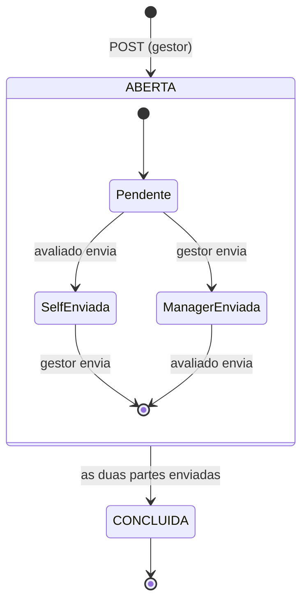

# 04 — Avaliações de Desempenho (`evaluations`)

| Campo | Valor |
|---|---|
| Status | 🏁 Concluída: EVAL-01..40 cobertos, 844 testes verdes na suíte completa (2026-11-24) |
| Versão | 1.0.0 |
| Data | 2026-11-24 |
| Depende de | [`00-architecture.spec.md`](00-architecture.spec.md) v1.3.0 (§2 RBAC, §3.4 `evaluations`, já com as emendas da §5.2; §5 itens 2 e 3) · [`01-auth.spec.md`](01-auth.spec.md) (sessão, envelope de erro) · [`02-users.spec.md`](02-users.spec.md) (`canViewUser`, padrão de 404, `requireRole`) · [`03-pd-goals.spec.md`](03-pd-goals.spec.md) (padrões de schema, ordem de avaliação, `idParam`, `withValidatedQuery`) |
| Branch | `feat/phase-4-evaluations` |

---

## 1. Objetivo

Permitir que o **GESTOR** abra, para cada **liderado direto**, uma avaliação de desempenho por **ciclo semestral** (`2026-S2`), e que ela seja preenchida em **duas partes independentes**:

- a **autoavaliação** (`selfScore`, `selfComments`), preenchida e enviada pelo **avaliado**;
- a **avaliação do gestor** (`managerScore`, `managerFeedback`), preenchida e enviada pelo **gestor**.

Cada parte é um rascunho editável até ser **enviada** (`submit`); depois disso fica imutável. Quando as duas partes forem enviadas, a avaliação fica `CONCLUIDA` e o resultado do gestor é **revelado** ao avaliado (regra anti-viés, §2.5).

**Fora do escopo desta fase:**
- excluir, cancelar ou reabrir uma avaliação (Q-06);
- transferir uma avaliação `ABERTA` para outro gestor quando o liderado muda de time (Q-05, §2.2);
- abertura em lote ("abrir o ciclo para a equipe inteira"): o gestor abre uma por liderado;
- avaliação 360°, competências ponderadas, calibração entre gestores (spec 00 §1.1);
- prazos de ciclo, lembretes e notificações;
- paginação e filtros além de `userId` e `cycle`;
- controle de concorrência otimista (dois PATCHes simultâneos na mesma parte: vale o último).

---

## 2. Regras de Domínio

### 2.1 Definições

| Termo | Definição |
|---|---|
| **Avaliado** (`userId`) | O usuário em `evaluations.user_id`. Pode ser um `COLABORADOR` ou um `GESTOR` que tenha gestor (spec 00 §5 item 3). |
| **Avaliador** (`managerId`) | O gestor direto do avaliado **no momento da abertura** (EVAL-INV-02). Fica gravado na avaliação (snapshot). |
| **Ciclo** (`cycle`) | Semestre no formato `AAAA-SN`: `2026-S1` (jan–jun) ou `2026-S2` (jul–dez). Ano entre `2000` e `2099`. |
| **Parte** | A autoavaliação (*self*) ou a avaliação do gestor (*manager*). Cada uma tem rascunho e envio próprios. |
| **Parte enviada** | `selfSubmittedAt` (ou `managerSubmittedAt`) preenchido. A parte fica imutável. |
| **Avaliação concluída** | `status = CONCLUIDA` ⇔ as duas partes foram enviadas (EVAL-INV-03). |

### 2.2 Política de acesso: `getEvaluationAccess(viewer, evaluatee, evaluation)`

Função **pura** em `evaluations.policy.ts`. Devolve o papel do viewer **naquela avaliação**:

```
if (evaluatee.id === viewer.id && evaluatee.isActive)                     return 'EVALUATEE'
if (evaluation.managerId === viewer.id && canViewUser(viewer, evaluatee)) return 'EVALUATOR'
return 'NONE'
```

O papel `EVALUATOR` exige **as duas condições**: ter aberto a avaliação (snapshot) **e** ainda ser o gestor direto do avaliado ativo (hierarquia atual, como na spec 03).

> **Limitação aceita no MVP (Q-05):** se o liderado mudar de gestor com a avaliação `ABERTA`, nenhum gestor consegue concluí-la: o antigo perde o acesso (hierarquia atual) e o novo não a abriu (snapshot). O avaliado continua acessando a própria parte. No MVP, `users.manager_id` só muda via seed, então o caso não ocorre pela API. Transferir a avaliação fica para uma feature futura.

| Viewer ↓ / Avaliação de → | Ele mesmo | Liderado direto ativo (aberta por ele) | Liderado direto inativo | Par da mesma equipe | Próprio gestor | Outro time | Ex-liderado (aberta por ele, hoje em outro time) |
|---|---|---|---|---|---|---|---|
| **COLABORADOR** | `EVALUATEE` | n/a | n/a | `NONE` | `NONE` | `NONE` | n/a |
| **GESTOR** | `EVALUATEE` | `EVALUATOR` | `NONE` | `NONE` | `NONE` | `NONE` | `NONE` |

> Um GESTOR avaliado pelo gestor *dele* é `EVALUATEE` na própria avaliação: preenche a autoavaliação como qualquer colaborador.

### 2.3 Matriz de permissões por ação

| Ação | `EVALUATEE` | `EVALUATOR` | `NONE` |
|---|---|---|---|
| Abrir avaliação (§4.1) | `403` (ninguém abre a própria) | n/a (o alvo é um liderado direto ativo) | `404` (usuário) |
| Listar / ver detalhe | ✅ (com ocultação, §2.5) | ✅ (com ocultação, §2.5) | `404` |
| Editar/enviar `selfScore`, `selfComments` | ✅ (se a parte não foi enviada) | `403` | `404` |
| Editar/enviar `managerScore`, `managerFeedback` | `403` | ✅ (se a parte não foi enviada) | `404` |

- Abrir avaliação é ação **de papel**: `POST` exige `requireRole('GESTOR')` (RBAC-02). Um COLABORADOR recebe `403` antes de qualquer consulta, então o `403` não revela nada.
- **Payload misto** (campos das duas partes) → `403` inteiro; nada é alterado (mesma regra da spec 03 GOAL-33).
- As partes são **independentes**: qualquer uma pode ser enviada primeiro.

### 2.4 Ciclo de vida



| # | Regra |
|---|---|
| **EVR-01** | `POST` cria a avaliação com `status = ABERTA` e as duas partes vazias (`null`). |
| **EVR-02** | Enquanto a parte **não** foi enviada, o dono dela pode salvar rascunho quantas vezes quiser; `null` limpa um campo. |
| **EVR-03** | Enviar (`submit: true`) exige, no estado final (rascunho salvo **ou** mesmo payload): na autoavaliação, `selfScore`; na avaliação do gestor, `managerScore` **e** `managerFeedback` (Q-07). Campo faltando → `400 VALIDATION_ERROR` com um item em `details` por campo faltante: `selfScore`/`managerScore` → "Informe a nota antes de enviar."; `managerFeedback` → "Informe o feedback antes de enviar." `selfComments` é opcional. |
| **EVR-04** | Ao enviar: `<parte>SubmittedAt = now`. Se a outra parte já estava enviada: `status = CONCLUIDA` (na mesma escrita). |
| **EVR-05** | Parte enviada é imutável: qualquer PATCH do dono dela → `409 EVALUATION_LOCKED`, mesmo com valores iguais aos atuais e mesmo que seja só `{ submit: true }` de novo. |
| **EVR-06** | `CONCLUIDA` é terminal: tudo é imutável (para os dois papéis, EVR-05 vale para ambas as partes). |

A função **pura** `applyEvaluationChanges(current, part, changes, now)` em `evaluations.rules.ts` implementa EVR-02..06 e é testada com a matriz completa.

### 2.5 Visibilidade (regra anti-viés)

A resposta é montada por uma função **pura** `toEvaluationDTO(evaluation, access)`, aplicada em **toda** rota que devolve avaliações (detalhe, listagem, criação e PATCH). Campos ocultos saem como `null`, com o mesmo formato do DTO.

| Campo | `EVALUATEE` com `ABERTA` | `EVALUATEE` com `CONCLUIDA` | `EVALUATOR`, self **não** enviada | `EVALUATOR`, self enviada |
|---|---|---|---|---|
| `selfScore`, `selfComments` | ✅ (é dele) | ✅ | 🙈 `null` (rascunho é privado) | ✅ |
| `managerScore`, `managerFeedback` | 🙈 `null` | ✅ | ✅ (é dele) | ✅ |
| `selfSubmittedAt`, `managerSubmittedAt`, `status` | ✅ | ✅ | ✅ | ✅ |

- **Avaliado (cego):** só vê a nota e o feedback do gestor quando a avaliação fica `CONCLUIDA`. Ele sabe **se** o gestor já enviou (`managerSubmittedAt`), mas não **o quê**. Assim a autoavaliação não é influenciada pela opinião do gestor.
- **Gestor:** vê a autoavaliação **depois de enviada** (spec 00 §2.1: "ver autoavaliação de liderado ✅ somente SUBMETIDA"); rascunhos nunca. Veja a Q-03 sobre torná-la cega também.
- A revelação é **automática**: o PATCH que conclui a avaliação já devolve o DTO completo para quem o fez.
- `null` num campo oculto é indistinguível de "não preenchido" **de propósito**; o front-end decide a mensagem pelo `status`/`*SubmittedAt`.

> **Por que ocultar no back-end, e não só na tela?** Esconder no front-end não é segurança: a resposta da API apareceria na aba *Network* do navegador. A regra fica no servidor e é testada por integração.

### 2.6 Regras de resposta para recursos fora do escopo (RBAC-03)

| Situação | Resposta (corpo **idêntico** dentro de cada linha) |
|---|---|
| `:id` inexistente **ou** avaliação com acesso `NONE` | `404 { "error": { "code": "NOT_FOUND", "message": "Avaliação não encontrada." } }` |
| `userId` (corpo do POST ou query do GET) inexistente, inativo ou fora do escopo | `404 { "error": { "code": "NOT_FOUND", "message": "Usuário não encontrado." } }` (spec 02 §2.4) |

### 2.7 Ordem de avaliação (todas as rotas)

```
401 (sessão) → 403 (papel, só no POST) → 400 (formato) → 404 (existência + escopo) → 403 (parte × papel) → 409 (estado) → 400 (nota obrigatória no envio) → 2xx
```

- O `requireRole('GESTOR')` do POST vem logo após o `requireAuth` (mesmo padrão de `/users/team`).
- O `400` do EVR-03 vem **por último** porque depende do rascunho salvo no banco: avaliá-lo antes do `404` revelaria algo sobre uma avaliação que o viewer não pode ver.

### 2.8 Novos códigos de erro

| HTTP | `code` | Quando | Mensagem |
|---|---|---|---|
| 409 | `EVALUATION_ALREADY_EXISTS` | Já existe avaliação para `(userId, cycle)` (EVAL-INV-01), inclusive na corrida entre dois POSTs (violação do `UNIQUE`). | "Já existe uma avaliação deste colaborador para o ciclo informado." |
| 409 | `EVALUATION_LOCKED` | PATCH numa parte já enviada ou em avaliação `CONCLUIDA` (EVR-05/06). | "Esta parte da avaliação já foi enviada e não pode ser alterada." |

---

## 3. Schemas de Validação (Zod)

### 3.1 `evaluationIdParamSchema` (`:id`)

`idParam("ID de avaliação inválido.")` (helper de `shared/schemas/id-param.ts`).

### 3.2 `listEvaluationsQuerySchema` (`GET /evaluations`): estrito

| Campo | Regras |
|---|---|
| `userId` | opcional · `idParam("ID de usuário inválido.")` |
| `cycle` | opcional · mesma regra de ciclo do §3.3 |

Parâmetro desconhecido → `400` com `field` = nome do parâmetro (mesma técnica do `catchall` da spec 03). Parâmetro repetido → `400`.

### 3.3 `createEvaluationSchema` (`POST /evaluations`): `strictObject`

| Campo | Regras | Mensagem |
|---|---|---|
| `userId` | **obrigatório** · inteiro positivo ≤ `4294967295` (número JSON) | "ID de usuário inválido." |
| `cycle` | **obrigatório** · string · regex `^(20\d{2})-S[12]$` (sem `trim`, sem minúsculas) | "Ciclo deve estar no formato AAAA-S1 ou AAAA-S2." |

- Qualquer outro campo (`status`, `managerId`, `selfScore`, `managerScore`, `id`...) → `400` (mass assignment). O `managerId` vem **sempre** do JWT (RBAC-04).

### 3.4 `updateEvaluationSchema` (`PATCH /evaluations/:id`): `strictObject`

| Campo | Regras | Parte |
|---|---|---|
| `selfScore` | `null` **ou** inteiro de 1 a 5 | self |
| `selfComments` | `null` **ou** string · `trim()` · 1 a 2000 caracteres | self |
| `managerScore` | `null` **ou** inteiro de 1 a 5 | manager |
| `managerFeedback` | `null` **ou** string · `trim()` · 1 a 2000 caracteres | manager |
| `submit` | opcional · somente o literal `true` | a parte do viewer |

- Pelo menos **um** campo (`field: "body"`). `{ "submit": true }` sozinho é válido (envia o rascunho salvo).
- `submit: false`, `"true"`, `1` → `400` (`field: "submit"`): para "não enviar", basta omitir.
- `""` e `"   "` nos comentários → `400`; para limpar, `null` (spec 02 D-07).
- `userId`, `managerId`, `cycle`, `status`, `selfSubmittedAt`, `managerSubmittedAt`, `id` etc. → `400`.
- O schema **aceita** payload misto; quem pode o quê é decidido no service, depois do `404` (§2.7).

---

## 4. Contrato da API

Prefixo: `/api/v1/evaluations`. **Todas** as rotas exigem `requireAuth`.

### 4.0 `EvaluationDTO`

```json
{
  "id": 7,
  "userId": 2,
  "managerId": 1,
  "cycle": "2026-S2",
  "status": "ABERTA",
  "selfScore": 4,
  "selfComments": "Entreguei a API de usuários com testes.",
  "selfSubmittedAt": "2026-12-01T14:00:00.000Z",
  "managerScore": null,
  "managerFeedback": null,
  "managerSubmittedAt": "2026-12-02T10:00:00.000Z",
  "createdAt": "2026-11-24T12:00:00.000Z",
  "updatedAt": "2026-12-02T10:00:00.000Z"
}
```

(Exemplo visto pelo **avaliado**: o gestor já enviou, mas a nota e o feedback dele seguem ocultos até a avaliação ficar `CONCLUIDA`.)

- `status`: `ABERTA` | `CONCLUIDA`. Horários em ISO 8601 UTC.
- O DTO não embute dados de usuário (só ids), então não há risco de vazar `password_hash`.

### 4.1 `POST /api/v1/evaluations`: abrir avaliação

Middlewares: `requireAuth` → `requireRole('GESTOR')` → `validateBody(createEvaluationSchema)`.

```json
{ "userId": 2, "cycle": "2026-S2" }
```

- `userId` = o próprio viewer → `403 FORBIDDEN` (ninguém abre a própria avaliação).
- `userId` que não é liderado direto **ativo** do viewer (inexistente, inativo, outro time, indireto) → `404 "Usuário não encontrado."`.
- Já existe avaliação para `(userId, cycle)` → `409 EVALUATION_ALREADY_EXISTS`.
- `managerId` = viewer.
- **Response `201 Created`**: `{ "evaluation": EvaluationDTO }` com `status: "ABERTA"` e todas as partes `null`.

### 4.2 `GET /api/v1/evaluations`: listar

Middlewares: `requireAuth` → `withValidatedQuery(listEvaluationsQuerySchema)`.

| Viewer | Sem `userId` | Com `?userId=<id>` |
|---|---|---|
| COLABORADOR | As **próprias** avaliações. | Só `userId` = ele mesmo; qualquer outro → `404` de usuário. |
| GESTOR | As avaliações da **equipe**: as que ele abriu (`managerId` = viewer) de liderados diretos **ativos**. **Não** inclui as dele como avaliado. | Liderado direto ativo → as avaliações desse liderado abertas por ele. Ele mesmo → as **próprias** (como avaliado). Outro → `404` de usuário. |

- `?cycle=2026-S2` filtra pelo ciclo em qualquer combinação.
- Ordenação: `cycle DESC, id ASC` (ciclo mais recente primeiro; `AAAA-SN` ordena corretamente como texto).
- A ocultação do §2.5 vale **item a item**.
- Lista vazia → `200 { "evaluations": [] }`.
- **Response `200 OK`**: `{ "evaluations": EvaluationDTO[] }`.

> **Divergência consciente da spec 03 (D-03):** lá, "sem `userId`" significa "as minhas" para qualquer papel. Aqui, como pedido, o gestor sem `userId` vê a equipe. Veja a Q-02.

### 4.3 `GET /api/v1/evaluations/:id`: detalhe

Middlewares: `requireAuth` → `withValidatedParams(evaluationIdParamSchema)`.

**Response `200 OK`**: `{ "evaluation": EvaluationDTO }` (com ocultação) se o acesso ≠ `NONE`; senão `404 "Avaliação não encontrada."`.

### 4.4 `PATCH /api/v1/evaluations/:id`: preencher / enviar a parte do viewer

Middlewares: `requireAuth` → `validateBody(updateEvaluationSchema)` → `withValidatedParams(evaluationIdParamSchema)` (mesma ordem aprovada na Fase 3).

```json
{ "selfScore": 4, "selfComments": "Entreguei a API de usuários." }
{ "submit": true }
{ "managerScore": 3, "managerFeedback": "Bom ritmo; aprofunde testes.", "submit": true }
{ "selfComments": null }
```

Fluxo no service: busca a avaliação e o avaliado → `404` se `NONE` → `403` se algum campo é da outra parte → `409` se a parte do viewer já foi enviada ou a avaliação está `CONCLUIDA` → `applyEvaluationChanges` (`400` do EVR-03: nota, e feedback do gestor) → grava → relê → `toEvaluationDTO`.

- `submit` sem campos de conteúdo envia o rascunho salvo.
- **Response `200 OK`**: `{ "evaluation": EvaluationDTO }`. Campos omitidos permanecem inalterados.

> Não há `DELETE` nesta fase (Q-06).

---

## 5. Banco de Dados

### 5.1 Migration `003_create_evaluations.sql`

| Coluna | Tipo | Restrições |
|---|---|---|
| `id` | `INT UNSIGNED` | PK, `AUTO_INCREMENT` |
| `user_id` | `INT UNSIGNED` | `NOT NULL`, FK → `users.id` `ON DELETE CASCADE` |
| `manager_id` | `INT UNSIGNED` | `NOT NULL`, FK → `users.id` `ON DELETE RESTRICT` |
| `cycle` | `CHAR(7)` | `NOT NULL` |
| `status` | `ENUM('ABERTA','CONCLUIDA')` | `NOT NULL`, default `'ABERTA'` |
| `self_score` | `TINYINT UNSIGNED` | `NULL`, `CHECK (self_score BETWEEN 1 AND 5)` |
| `self_comments` | `TEXT` | `NULL` |
| `self_submitted_at` | `DATETIME` | `NULL` |
| `manager_score` | `TINYINT UNSIGNED` | `NULL`, `CHECK (manager_score BETWEEN 1 AND 5)` |
| `manager_feedback` | `TEXT` | `NULL` |
| `manager_submitted_at` | `DATETIME` | `NULL` |
| `created_at` / `updated_at` | `DATETIME` | como em `users` |

Índices: `UNIQUE(user_id, cycle)`, `INDEX(manager_id, cycle)` (listagem da equipe).

**Invariantes (validadas no service; spec 00 §3.5 explica por que não há `CHECK` envolvendo ids):**
- **EVAL-INV-01:** uma avaliação por pessoa por ciclo (`UNIQUE`; violação → `409 EVALUATION_ALREADY_EXISTS`).
- **EVAL-INV-02:** `manager_id` é o `users.manager_id` do avaliado no momento da abertura, e `manager_id <> user_id`.
- **EVAL-INV-03:** `status = CONCLUIDA` ⇔ `self_submitted_at` e `manager_submitted_at` preenchidos.
- **EVAL-INV-04:** enviar a autoavaliação exige `self_score`; enviar a avaliação do gestor exige `manager_score` e `manager_feedback`. Depois de enviada, a parte é imutável.

### 5.2 Emendas à spec 00 (aprovadas e aplicadas na v1.3.0)

| # | Mudança na spec 00 | Motivo |
|---|---|---|
| E-01 | §3.4: **uma linha por `(user_id, cycle)`** com as duas partes, em vez de uma linha por `type` (`AUTOAVALIACAO`/`GESTOR`). Remove `type`, `score`, `strengths`, `improvements`, `comments`; adiciona as colunas `self_*` e `manager_*` da §5.1. | O fluxo pedido trata a avaliação como **um recurso** (um `:id`, um PATCH para as duas partes, revelação quando ambas terminam). Com duas linhas, a regra de revelação dependeria de ler outra linha e a API precisaria agregar dois registros. |
| E-02 | Renomear `evaluatee_id` → `user_id` e `evaluator_id` → `manager_id`. | Mesmo nome no banco e na API (`userId`, `managerId`), como a E-01 da spec 03 (`target_date`). |
| E-03 | `status`: `RASCUNHO`/`SUBMETIDA` (por linha) → `ABERTA`/`CONCLUIDA` (da avaliação), mais `self_submitted_at`/`manager_submitted_at` (por parte). | O "rascunho/submetida" passa a ser de cada parte; o status geral resume as duas. |
| E-04 | Índices: `UNIQUE(evaluatee_id, cycle, type)` → `UNIQUE(user_id, cycle)`; `INDEX(evaluator_id)` → `INDEX(manager_id, cycle)`. | Consequência da E-01; o índice composto cobre a listagem da equipe com filtro de ciclo. |
| E-05 | Invariantes EVAL-INV-01..04 reescritas como na §5.1. | Consequência da E-01..E-03. |
| E-06 | §2.1, matriz: "criar/editar a própria autoavaliação (rascunho)" → "**preencher** a própria autoavaliação (a avaliação é aberta pelo gestor)"; nova linha "**abrir avaliação de liderado direto**: COLABORADOR ❌, GESTOR ✅"; "ver avaliação do gestor sobre si" → "somente `CONCLUIDA`". | Reflete quem inicia o ciclo e a regra anti-viés (§2.5). |

Nenhuma migration de `evaluations` existe ainda: as emendas não exigem migração de dados.

---

## 6. Critérios de Aceite

> Convenção: `it('[EVAL-07] ...')`. **I** = integração (Supertest + `onepulse_test`); **U** = unitário.
> Notação (fixture das specs 02/03): **G** = gestor, **C1/C2** = liderados diretos ativos de G, **Ci** = liderado inativo de G, **N** = liderado de C1 (indireto para G), **G2** = outro gestor, **X** = liderado de G2. Para os casos em que G é avaliado, **GG** = gestor de G. `999999` = id inexistente.

### 6.1 Abertura: `POST /evaluations`

| ID | Dado / Quando | Então | Tipo |
|---|---|---|---|
| **EVAL-01** | G abre avaliação para C1 no ciclo `2026-S2` | `201 { evaluation }` com `userId = C1`, `managerId = G`, `status: ABERTA`, as 6 colunas das partes `null`; a linha existe no banco. | I |
| **EVAL-02** | Já existe avaliação de C1 em `2026-S2`; G abre de novo | `409 EVALUATION_ALREADY_EXISTS`; nada é criado. Para C1 em `2026-S1` → `201` (outro ciclo). | I |
| **EVAL-03** | G com `userId` ∈ {X, Ci, N, 999999} | `404 "Usuário não encontrado."`, corpos idênticos; nada é criado. | I (`it.each`) |
| **EVAL-04** | C1 (COLABORADOR) abre para si ou para C2; G abre para si mesmo | `403 FORBIDDEN`; nada é criado. | I (`it.each`) |
| **EVAL-05** | Corpo inválido: não-objeto; sem `userId`; `userId` ∈ {`0`, `-1`, `"2"`, `1.5`, `4294967296`}; sem `cycle`; `cycle` ∈ {`2026-S3`, `2026-Q4`, `2026-s1`, `26-S1`, `1999-S1`, `2100-S1`, `" 2026-S1"`, `2026`, `null`} | `400 VALIDATION_ERROR` com `details[].field` correspondente. | I + U (schema) |
| **EVAL-06** | Campo proibido: `managerId`, `status`, `selfScore`, `managerScore`, `selfSubmittedAt`, `id` | `400` com `field` = o campo; nada é criado. | I + U (schema) |
| **EVAL-07** | Sem cookie de sessão (corpo válido e inválido) | `401 UNAUTHENTICATED`. | I |
| **EVAL-08** | Repository sinaliza violação do `UNIQUE` (dois POSTs simultâneos) | O service responde `409 EVALUATION_ALREADY_EXISTS`, não `500`. | U (fake repository) |

### 6.2 Listagem: `GET /evaluations`

| ID | Dado / Quando | Então | Tipo |
|---|---|---|---|
| **EVAL-09** | Existem avaliações de C1 (2 ciclos), C2, G (aberta por GG), X; C1 lista sem `userId` | `200 { evaluations }` só com as de C1, ordenadas por `cycle DESC, id ASC`. | I |
| **EVAL-10** | G lista sem `userId` | As de C1 e C2 (abertas por G); **não** inclui a do próprio G, a de X nem a de Ci (inativo). | I |
| **EVAL-11** | G com `?userId=C1`; G com `?userId=G` | As de C1; as do próprio G como avaliado. | I |
| **EVAL-12** | G com `?userId` ∈ {X, Ci, N, 999999}; C1 com `?userId` ∈ {C2, G} | `404 "Usuário não encontrado."`, corpos idênticos. | I (`it.each`) |
| **EVAL-13** | `?cycle=2026-S2` (C1 e G); ciclo sem avaliações | Só as do ciclo; `200 { "evaluations": [] }` quando não há. | I |
| **EVAL-14** | `?userId` ∈ {`abc`, `0`, `01`, `4294967296`}; `?cycle=2026-Q4`; `?status=ABERTA`; `?userId=1&userId=2` | `400 VALIDATION_ERROR`. | I + U (schema) |
| **EVAL-15** | Na listagem, C1 vê avaliação `ABERTA` com o gestor já enviado; G vê avaliação com a autoavaliação em rascunho | Campos ocultos como no §2.5, item a item. | I |
| **EVAL-16** | Sem cookie de sessão | `401`. | I |

### 6.3 Detalhe: `GET /evaluations/:id`

| ID | Dado / Quando | Então | Tipo |
|---|---|---|---|
| **EVAL-17** | C1 consulta a própria; G consulta a de C1; G consulta a própria (aberta por GG) | `200 { evaluation }`. | I |
| **EVAL-18** | C2 → de C1; X → de C1; G2 → de C1; G → de Ci (inativo); G → de X; C1 → de G; `999999` | `404 "Avaliação não encontrada."`, corpos idênticos. | I (`it.each`) |
| **EVAL-19** | `:id` ∈ {`abc`, `0`, `-1`, `1.5`, `1e3`, `01`, `4294967296`} | `400`, `field: "id"`. | I + U (schema) |
| **EVAL-20** | Sem cookie de sessão (id válido e inválido) | `401`. | I |

### 6.4 Visibilidade (anti-viés)

| ID | Dado / Quando | Então | Tipo |
|---|---|---|---|
| **EVAL-21** | Avaliação `ABERTA` com a parte do gestor **enviada** e a self pendente; C1 consulta | `managerScore` e `managerFeedback` `null`; `managerSubmittedAt` preenchido; a própria parte visível. | I |
| **EVAL-22** | Mesmo cenário; C1 envia a autoavaliação | A resposta do PATCH já vem `CONCLUIDA` com `managerScore` e `managerFeedback` **revelados**; um `GET` seguinte também. | I |
| **EVAL-23** | Autoavaliação em **rascunho** (nota e comentário salvos, não enviados); G consulta. Depois C1 envia; G consulta de novo | 1º: `selfScore`/`selfComments` `null` para G. 2º: visíveis. | I |
| **EVAL-24** | Matriz completa do §2.5 em `toEvaluationDTO` (acesso × status × partes enviadas) | Oculta/mostra exatamente como a tabela; o formato do DTO não muda. | U (`it.each`) |

### 6.5 Atualização pelo avaliado (autoavaliação)

| ID | Dado / Quando | Então | Tipo |
|---|---|---|---|
| **EVAL-25** | C1 salva `{ selfScore: 4, selfComments: "  Texto  " }`; depois `{ selfComments: null }`; depois `{ selfScore: null }` | `200`; persistido (com `trim`); `selfSubmittedAt` segue `null`; os `null` limpam cada campo e preservam o outro. | I |
| **EVAL-26** | C1 envia `{ submit: true }` com rascunho com nota; e, em outra avaliação, `{ selfScore: 3, submit: true }` num único PATCH | `200`, `selfSubmittedAt` preenchido, `status: ABERTA` (gestor pendente). | I |
| **EVAL-27** | C1 envia `{ submit: true }` sem nota no rascunho; e `{ selfScore: null, submit: true }` | `400`, `field: "selfScore"`, "Informe a nota antes de enviar."; nada muda. | I |
| **EVAL-28** | Autoavaliação já enviada; C1 envia `{ selfComments }`, `{ selfScore }` ou `{ submit: true }` | `409 EVALUATION_LOCKED`; nada muda. | I (`it.each`) |
| **EVAL-29** | C1 envia `{ managerScore }`, `{ managerFeedback }` ou `{ selfScore, managerScore }` | `403 FORBIDDEN`; nada muda. | I (`it.each`) |

### 6.6 Atualização pelo gestor e regras gerais

| ID | Dado / Quando | Então | Tipo |
|---|---|---|---|
| **EVAL-30** | G salva rascunho `{ managerScore: 3, managerFeedback }` e depois envia `{ submit: true }` com a self pendente. Em outras avaliações, G envia `{ submit: true }` sem nota, sem feedback, ou sem os dois | 1º: `200`; `managerSubmittedAt` preenchido; `status: ABERTA`. Sem nota/feedback: `400` com `field` = `managerScore` e/ou `managerFeedback` (Q-07); nada muda. | I |
| **EVAL-31** | Self já enviada; G envia a parte dele | `200`, `status: CONCLUIDA` (EVR-04, ordem inversa do EVAL-22). | I |
| **EVAL-32** | G envia `{ selfScore }`; G envia `{ managerFeedback, selfComments }` (misto) | `403`; **nada** muda. | I (`it.each`) |
| **EVAL-33** | Parte do gestor já enviada → G envia qualquer campo; avaliação `CONCLUIDA` → C1 e G enviam qualquer campo | `409 EVALUATION_LOCKED`; nada muda. | I (`it.each`) |
| **EVAL-34** | G é avaliado por GG: G preenche a própria `selfScore` → `200`; G envia `managerScore` na própria avaliação → `403` | Gestor avaliado é `EVALUATEE` na própria avaliação. | I |
| **EVAL-35** | PATCH por X, C2, G2 ou em `999999` | `404 "Avaliação não encontrada."`, corpo idêntico ao EVAL-18; nada muda. | I (`it.each`) |
| **EVAL-36** | X envia corpo **inválido** para a avaliação de C1 | `400` (validação antes do escopo). | I |
| **EVAL-37** | Corpo inválido: `{}`; não-objeto; nota ∈ {`0`, `6`, `3.5`, `"3"`}; comentários ∈ {`""`, `"   "`, 2001 caracteres}; `submit` ∈ {`false`, `"true"`, `1`, `null`}; campos proibidos (`userId`, `managerId`, `cycle`, `status`, `selfSubmittedAt`, `managerSubmittedAt`, `id`) | `400 VALIDATION_ERROR` com o `field` correspondente. | I + U (schema) |
| **EVAL-38** | Sem cookie de sessão | `401`. | I |
| **EVAL-39** | Matriz completa do §2.2 em `getEvaluationAccess`, incluindo o ex-liderado (avaliação aberta por G, avaliado hoje em outro time) | `EVALUATEE`/`EVALUATOR`/`NONE` exatamente como a tabela. | U (`it.each`) |
| **EVAL-40** | Regras EVR-02..06 em `applyEvaluationChanges` (com `now` fixo): rascunho, `null` limpa, envio com nota do rascunho/do payload, envio sem nota (self) e sem nota/feedback (gestor), `selfComments` opcional, conclusão nas duas ordens, parte travada, `CONCLUIDA` travada, não muta a entrada | Estado final e erros exatamente como o §2.4. | U (`it.each`) |

---

## 7. Decisões desta Spec

| # | Decisão | Alternativa descartada | Motivo |
|---|---|---|---|
| D-01 | Um registro por `(user_id, cycle)` com duas partes (emendas E-01..E-05) | Duas linhas por ciclo (`type`), como na spec 00 v1.2.0 | Um recurso, um `:id`, revelação calculada a partir de uma única linha. |
| D-02 | Só o GESTOR abre a avaliação, para liderado direto ativo | O colaborador cria a própria autoavaliação | Pedido de produto: o ciclo é conduzido pelo gestor; o `managerId` fica fixado na abertura (EVAL-INV-02). |
| D-03 | Partes independentes, em qualquer ordem | Exigir a autoavaliação antes da avaliação do gestor | Não bloqueia o gestor; a regra anti-viés já protege o avaliado. |
| D-04 | Envio via `submit: true` no PATCH | Rota `POST /evaluations/:id/submit` | Mantém o contrato pedido (um PATCH) e permite "preencher e enviar" numa chamada só. |
| D-05 | Ocultação no back-end por função pura (`toEvaluationDTO`), campos ocultos como `null` | Ocultar só no front-end; omitir as chaves | Segurança real (a resposta é o que vaza); DTO com formato fixo facilita a tipagem no front-end. |
| D-06 | Nota obrigatória para enviar → `400` com `field`, avaliado **depois** do `409` | `409` com código próprio | É um erro de preenchimento que a UI destaca no campo; vem por último porque depende do rascunho salvo. |
| D-07 | `EVALUATOR` exige snapshot **e** hierarquia atual | Só o snapshot; só a hierarquia atual | O gestor antigo perde acesso ao sair da liderança (como na spec 03), e um gestor novo não assume uma avaliação que não abriu. |
| D-08 | Escala de 1 a 5 (inteiro) | 0–10, conceitos (A–E) | Mantém a spec 00 e o `CHECK` simples do MySQL. |
| D-09 | Envio do gestor exige nota **e** feedback; o do avaliado, só a nota | Só a nota nos dois | Uma nota sem justificativa tem pouco valor para o PDI do liderado (Q-07). |

---

## 8. Decisões de Produto (resolvidas em 2026-11-24)

- **Q-01: Modelo de dados.** Registro único por `(user_id, cycle)` com duas partes; emendas E-01..E-06 aplicadas na spec 00 v1.3.0.
- **Q-02: Listagem do gestor sem `userId`.** Traz as avaliações da **equipe** (§4.2), divergindo conscientemente da spec 03 D-03.
- **Q-03: Visibilidade.** O gestor vê a autoavaliação **depois de enviada** (rascunho nunca); o avaliado vê a avaliação do gestor **somente** com `CONCLUIDA` (§2.5).
- **Q-04: Ciclos.** Somente semestrais (`AAAA-SN`); `2026-Q4` e afins → `400`.
- **Q-05: Troca de gestor no meio do ciclo.** Limitação aceita e documentada (§2.2); transferência fora do MVP.
- **Q-06: Exclusão/cancelamento de avaliação.** Fora do MVP.
- **Q-07: Campos obrigatórios no envio.** Gestor: `managerScore` **e** `managerFeedback`. Avaliado: só `selfScore` (`selfComments` opcional). Veja EVR-03 e D-09.

---

## 9. Plano de Testes (prévia para a etapa RED)

```
backend/
├── database/migrations/
│   └── 003_create_evaluations.sql
├── src/modules/evaluations/
│   ├── evaluations.policy.test.ts        # EVAL-39
│   ├── evaluations.rules.test.ts         # EVAL-40 (applyEvaluationChanges)
│   ├── evaluations.visibility.test.ts    # EVAL-24 (toEvaluationDTO)
│   ├── evaluations.schemas.test.ts       # EVAL-05, 06, 14, 19, 37 (U)
│   └── evaluations.service.test.ts       # EVAL-08 (fake repository)
└── tests/
    ├── fixtures/evaluations.fixtures.ts
    ├── helpers/
    │   ├── db.ts                         # resetDatabase: + DELETE FROM evaluations
    │   └── evaluations.ts                # insertEvaluation(...), evaluationsApi, asserts
    └── integration/evaluations/
        ├── create-evaluation.test.ts     # EVAL-01..07
        ├── list-evaluations.test.ts      # EVAL-09..16
        ├── get-evaluation.test.ts        # EVAL-17..20
        ├── visibility.test.ts            # EVAL-21..23
        ├── update-self.test.ts           # EVAL-25..29
        └── update-manager.test.ts        # EVAL-30..38
```
